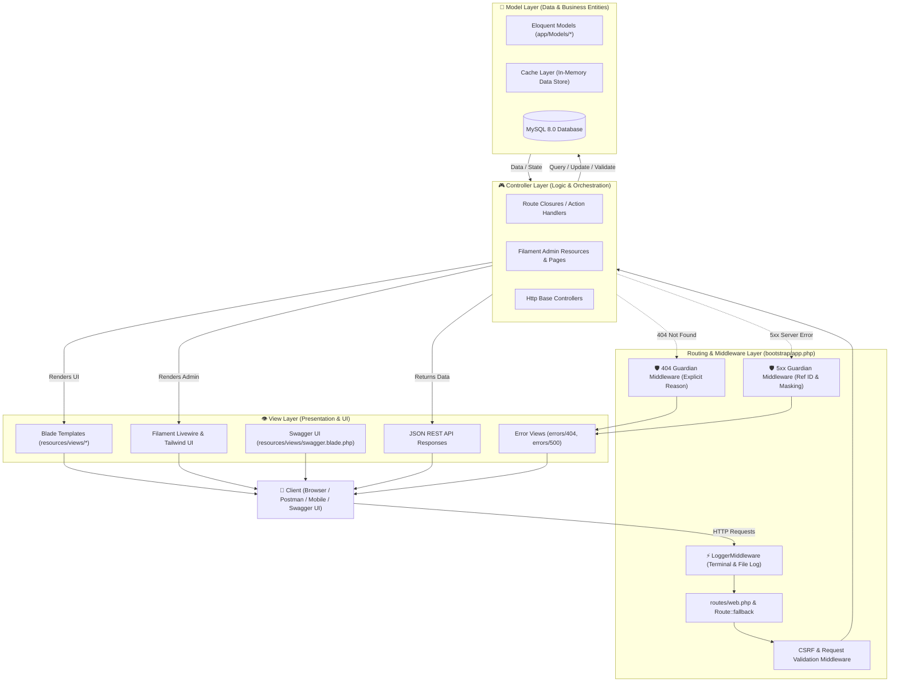
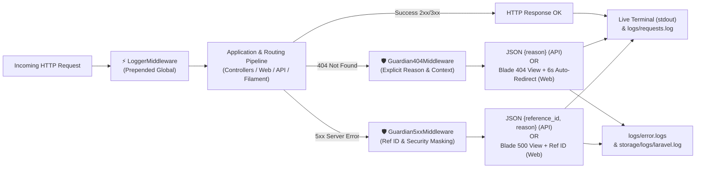

# 🎓 Alumni Tracking System


A modern, full-featured **Alumni Tracking System** built for universities, faculties, and educational institutions to foster sustainable relationships with graduates, monitor career progression, and cultivate an active alumni community.

> 📊 **Data Design Documentation:** Detailed Entity-Relationship Diagram (ERD), Data Dictionary, and persistence models are documented in [**ddd.md**](ddd.md) / [**add.md**](add.md).  
> 🎨 **Brand Identity & Design System:** Official color palette, typography hierarchy, UI tokens, and badge guidelines are documented in [**brand.md**](brand.md) &bull; Visual architecture & Refero design references in [**DESIGN.md**](DESIGN.md).

---

## 📑 Documentation Quick Links & Anchors

| Document | Description | Direct Anchor |
| :--- | :--- | :---: |
| 🎨 **Brand Guidelines** | Official institutional color palette, Plus Jakarta Sans font scale, workplace badges, UI tokens & usage rules | [**`brand.md` →**](brand.md) |
| 📐 **Visual Design System** | Refero Design references (Fictional, Family, Fable, SuperHi, TOMO, MindMarket), paper-cut layouts, card blueprints | [**`DESIGN.md` →**](DESIGN.md) |
| 🗄️ **Data Design Document** | Complete Entity-Relationship (ER) model, database tables, data dictionary & field constraints | [**`ddd.md` →**](ddd.md) \| [**`add.md` →**](add.md) |
| 📡 **API & Swagger Docs** | Interactive OpenAPI 3.0 REST API documentation, endpoints, test payloads | [**Jump to API Section ↓**](#-restful-api--interactive-swagger-documentation) |
| 🎨 **Brand Section (Summary)** | Quick overview of design rules, semantic badges, and visual tokens within README | [**Jump to Brand Section ↓**](#-brand-identity--design-system-guidelines) |

---

## 🚀 About The Project

This application is built with the robust **Laravel 11** framework, a high-performance **Filament v3** administration panel, a scalable **MySQL** database, and is fully containerized using **Docker & Docker Compose** for seamless local development and deployment.

### 🌟 Key Features

- **👥 Role-Based Access Control (RBAC):**
  - **Super Admin:** Full system control, department/faculty management, access configuration.
  - **Department Coordinator:** Monitor, verify, and report alumni records belonging to their department.
  - **Alumni:** Update profiles, manage work experience, browse/post job openings, and network with peers.
- **🛡️ Alumni Verification Workflow:**
  - Student ID & graduation verification with manual or automatic administrator approval states.
- **💼 Career & Job Board & Domain Rules:**
  - Job and internship posting board managed by alumni and institution coordinators, with direct application support.
  - **Strict Domain Rules:** `title` (required), `company_name` (required), `workplace_type` (mandatory: `hybrid`, `remote`, `in-office`), `salary` (mandatory: non-negative decimal), with optional `city`, `description`, and `benefits`.
- **🛡️ Middleware Guardians & Observability:**
  - **Live Terminal & File Logger (`LoggerMiddleware`):** Real-time request logging to terminal (`php://stdout`) formatted as `time method route res.type duration` (e.g. `10:20:30 POST /user 201 18ms`) with dual-destination logging to `logs/requests.log` and `logs/error.logs`.
  - **404 Guardian (`Guardian404Middleware`):** Intercepts 404 Not Found errors, returning explicit human-readable reasons (JSON for API, custom styled Blade view for web).
  - **5xx Guardian (`Guardian5xxMiddleware`):** Catches 500 server errors, generates unique tracking reference codes (`ERR-XXXXXXXX`), masks sensitive internal credentials, and logs full context to `logs/error.logs`.
  - **Generic 404 Page & Fallback Redirects:** Dedicated `/404` route with dynamic reason card and automatic 6-second countdown redirect to `/main`, plus `Route::fallback()` catching unmapped URLs.
  - **Dedicated Root File Logging (`logs/error.logs`):** Dedicated project root `logs/` directory storing historical errors and request logs for long-term auditing and analysis.
- **🔍 Advanced Search & Filtering:**
  - Instantly search and filter graduates by graduation year, faculty, department, industry, current company, and location.
- **📊 Modern Dashboard (Filament v3):**
  - Interactive statistic widgets (total alumni, employment rate, leading industries).
  - Bulk data exports (CSV, Excel, PDF).
- **📅 Events & Announcements:**
  - Organize alumni reunions, webinars, panels, and networking meetups with RSVP tracking.
- **🐳 Dockerized Architecture:**
  - Isolated environment for PHP 8.2+, Nginx, MySQL, and Redis managed via Docker Compose.

---

## 🛠️ Tech Stack

| Layer | Technology | Description |
| :--- | :--- | :--- |
| **Containerization** | Docker & Docker Compose | Containerized application and database services |
| **Backend** | PHP 8.2+ & Laravel 11.x | Modern MVC architecture, RESTful API, Eloquent ORM |
| **Admin Panel** | Filament v3 | TALL stack powered (Tailwind, Alpine.js, Laravel, Livewire) admin UI |
| **Database** | MySQL 8.x | High-performance relational database model |
| **Styling & UI** | Tailwind CSS & Livewire | Clean, responsive, and reactive front-end interface (See [**brand.md**](brand.md) & [**DESIGN.md**](DESIGN.md)) |
| **Authorization** | Spatie Laravel-Permission / Filament Shield | Granular role and permission management |

---

## 📋 Prerequisites

Ensure you have the following installed on your host machine:

* **[Docker Desktop](https://www.docker.com/products/docker-desktop/)** (Docker Engine & Docker Compose v2+)
* **Git**

*(Optional if running locally without Docker: PHP >= 8.2, Composer >= 2.x, Node.js >= 18)*

---

## 🐳 Docker Compose Quickstart (Recommended)

Running the project with Docker ensures that all dependencies (PHP, MySQL, extensions) run in isolated containers without needing local installations.

### 1. Clone the Repository
```bash
git clone https://github.com/gamze-sueda-akpinar/alumni.git
cd alumni
```

### 2. Environment Configuration
Copy `.env.example` to create your local `.env` file:
```bash
cp .env.example .env
```

Ensure your `.env` contains the matching Docker database service configurations:
```env
DB_CONNECTION=mysql
DB_HOST=mysql
DB_PORT=3306
DB_DATABASE=alumni_db
DB_USERNAME=alumni_user
DB_PASSWORD=alumni_secret
```

### 3. Build & Start Containers
Launch the application and database containers in detached mode:
```bash
docker compose up -d --build
```

### 4. Install Dependencies
Run Composer and NPM within the running application container:
```bash
docker compose exec app composer install
docker compose exec app npm install
docker compose exec app npm run build
```

### 5. Application Setup & Migrations
Generate application key, link storage, and run database migrations:
```bash
docker compose exec app php artisan key:generate
docker compose exec app php artisan storage:link
docker compose exec app php artisan migrate --seed
```

### 6. Create Filament Admin Account
Create your administrative credentials to log in to the Filament panel:
```bash
docker compose exec app php artisan make:filament-user
```
*(Enter your Name, Email, and Password when prompted)*

### 7. Access the Application
Open your browser and navigate to:
* **Public Web Portal:** `http://localhost:8000`
* **Filament Admin Panel:** `http://localhost:8000/admin`

---

## 💻 Alternative: Local Setup (Without Docker)

If you prefer to run the application directly on your local system with **PHP, Composer, Node.js, and MySQL** installed:

```bash
# 1. Install dependencies
composer install
npm install

# 2. Setup environment & key
cp .env.example .env
php artisan key:generate

# 3. Migrate and seed
php artisan migrate --seed
php artisan storage:link

# 4. Create admin user
php artisan make:filament-user

# 5. Build assets and start server
npm run build
php artisan serve
```

---

## 🗄️ Database Schema Overview

> [!IMPORTANT]
> For the comprehensive Data Dictionary, column-by-column schemas, Mermaid ER Diagram, referential integrity rules, and "The Forgetting Test" persistence proofs, please review the formal **[Data Design Documentation (ddd.md / add.md)](ddd.md)**.

The database architecture is structured around key relational entities:

```text
├── users (Authentication, credentials, and core user attributes)
├── roles & permissions (RBAC permission matrix)
├── faculties (Faculties and academic units)
├── departments (Academic departments linked to faculties)
├── alumni_profiles (Graduation year, student ID, status, contact details)
├── experiences (Work and internship history)
├── job_postings (Career opportunities and requirements)
├── job_applications (Job applications submitted by alumni)
└── events (Reunions, workshops, and networking announcements)
```

---

## 🏗️ MVC (Model-View-Controller) Architecture

This application is engineered using **Laravel 11** adhering to the industry-standard **Model-View-Controller (MVC)** architectural pattern, integrated with **Filament v3** (TALL Stack) and a dedicated **RESTful API & Swagger Documentation Layer**.



### 1. 🧠 Model (M) — Data Structures, Relationships & Business Rules
The **Model** layer encapsulates data schema, database interaction, business rules, and entity relationships using Laravel's **Eloquent ORM**:

* **[`app/Models/User.php`](app/Models/User.php):** Core authentication and user management entity. Represents administrators, department coordinators, and alumni.
* **[`app/Models/InMemoryUser.php`](app/Models/InMemoryUser.php):** Non-database standalone User Model providing full CRUD operations (`all()`, `find($id)`, `create($data)`, `update($id, $data)`, `delete($id)`) via in-memory caching.
* **[`app/Models/UserModel.php`](app/Models/UserModel.php):** Extended alias for the non-database User Model.
* **[`app/Models/Announcement.php`](app/Models/Announcement.php):** Non-database standalone Announcement Model with full CRUD operations (`all()`, `find($id)`, `published()`, `pinned()`, `byCategory()`, `create()`, `update()`, `delete()`) and mock dataset.
* **[`app/Models/InMemoryAnnouncement.php`](app/Models/InMemoryAnnouncement.php):** Non-database Announcement Model alias.
* **[`app/Models/AlumniProfile.php`](app/Models/AlumniProfile.php):** Core alumni data model containing graduation year, student number, approval status, city, current company, and position. Belongs to `User` and `Department`.
* **[`app/Models/Faculty.php`](app/Models/Faculty.php):** Academic faculties (e.g., Faculty of Engineering). Has a one-to-many relationship with `Department`.
* **[`app/Models/Department.php`](app/Models/Department.php):** Academic departments (e.g., Computer Engineering, MIS). Belongs to `Faculty` and has many `AlumniProfile` records.
* **[`app/Models/Experience.php`](app/Models/Experience.php):** Tracks professional career history, internship records, and current employment for graduates.
* **[`app/Models/JobPosting.php`](app/Models/JobPosting.php):** Career openings, internships, and job advertisements shared for alumni. Enforces strict domain validation rules:
  - **Required:** `title`, `company_name`
  - **Mandatory:** `workplace_type` (strictly `hybrid`, `remote`, or `in-office`), `salary` (numeric >= 0)
  - **Optional:** `city`, `location`, `description`, `benefits`, `requirements`, `application_deadline`, `contact_email`
* **[`app/Models/InMemoryJobPosting.php`](app/Models/InMemoryJobPosting.php):** Non-database standalone JobPosting Model with full CRUD operations (`all()`, `find($id)`, `active()`, `byCompany()`, `create()`, `update()`, `delete()`) and mock dataset.
* **[`app/Models/Event.php`](app/Models/Event.php):** Reunions, seminars, conferences, and networking events for graduates.
* **`database/migrations/`:** Database blueprint definitions establishing foreign keys, constraints, and table columns in MySQL.

### 2. 👁️ View (V) — Presentation & User Interfaces
The **View** layer handles presenting data to users, structuring layouts, and rendering interactive front-end screens:

* **Blade Templates ([`resources/views/`](resources/views/)):**
  * **[`resources/views/users/index.blade.php`](resources/views/users/index.blade.php):** Web user directory & listing view (`GET /users` — Read) with responsive table, action buttons (Show, Edit, Delete), and quick creation form (`POST /users` — Create).
  * **[`resources/views/users/show.blade.php`](resources/views/users/show.blade.php):** Detailed single user profile view (`GET /users/{id}` — Read Single) with edit and delete actions.
  * **[`resources/views/users/edit.blade.php`](resources/views/users/edit.blade.php):** User profile editing form view (`GET /users/{id}/edit` — Update Form) with `@method('PUT')`.
  * **[`resources/views/users/create.blade.php`](resources/views/users/create.blade.php):** Dedicated user registration form view (`GET /users/create` — Create Form).
  * **[`resources/views/announcements/index.blade.php`](resources/views/announcements/index.blade.php):** Announcements listing & directory view (`GET /announcements` — Read) with category badges, pinned announcement highlighting, action buttons, and quick creation form (`POST /announcements` — Create).
  * **[`resources/views/announcements/show.blade.php`](resources/views/announcements/show.blade.php):** Detailed single announcement view (`GET /announcements/{id}` — Read Single) displaying title, category, audience, publisher, and full body content.
  * **[`resources/views/announcements/edit.blade.php`](resources/views/announcements/edit.blade.php):** Announcement editing form view (`GET /announcements/{id}/edit` — Update Form) with `@method('PUT')`.
  * **[`resources/views/announcements/create.blade.php`](resources/views/announcements/create.blade.php):** Standalone announcement publication form view (`GET /announcements/create` — Create Form).
  * **[`resources/views/job_postings/index.blade.php`](resources/views/job_postings/index.blade.php):** Job postings listing & career board view (`GET /job-postings` — Read) with company badges, active status, quick posting form (`POST /job-postings` — Create), and action buttons.
  * **[`resources/views/job_postings/show.blade.php`](resources/views/job_postings/show.blade.php):** Detailed single job posting view (`GET /job-postings/{id}` — Read Single) with responsibilities, qualifications, and deadline.
  * **[`resources/views/job_postings/edit.blade.php`](resources/views/job_postings/edit.blade.php):** Job posting editing form view (`GET /job-postings/{id}/edit` — Update Form) with `@method('PUT')`.
  * **[`resources/views/job_postings/create.blade.php`](resources/views/job_postings/create.blade.php):** Standalone job posting publication form view (`GET /job-postings/create` — Create Form).
  * **[`resources/views/applications/index.blade.php`](resources/views/applications/index.blade.php):** Job applications tracker (ATS) interface (`GET /applications` — Read) with stage metrics (Pending, Reviewed, Interview, Accepted, Rejected), candidate contact info, cover letter previews, and resume links.
  * **[`public/app_preview.html`](public/app_preview.html):** Zero-dependency, interactive multi-page design preview simulator enabling instant browser testing of every redesigned page without a running server.
  * **[`resources/views/main.blade.php`](resources/views/main.blade.php):** Responsive, modern landing and home page designed with Tailwind CSS, featuring alumni success highlights and navigation.
  * **[`resources/views/about.blade.php`](resources/views/about.blade.php):** About page presenting the purpose and vision of the Alumni Tracking System.
  * **[`resources/views/swagger.blade.php`](resources/views/swagger.blade.php):** Embedded, interactive **Swagger UI 5.x** interface for live API exploration and testing directly in the browser.
  * **[`resources/views/welcome.blade.php`](resources/views/welcome.blade.php):** Default framework landing template.
  * **[`resources/views/errors/404.blade.php`](resources/views/errors/404.blade.php):** Generic 404 Not Found error view designed with Tailwind CSS. Features dynamic reason card, quick resource shortcuts, and an interactive 6-second countdown timer that automatically redirects visitors to the home portal (`/main`).
  * **[`resources/views/errors/500.blade.php`](resources/views/errors/500.blade.php):** Custom 500 Internal Server Error page displaying a unique tracking reference code (`reference_id`), safe human-readable explanation, masked diagnostics, and action buttons to reload or return home.
* **Filament v3 Admin Panel UI:**
  * Powered by the **TALL stack** (Tailwind CSS, Alpine.js, Laravel, Livewire). Renders reactive administration dashboards, data tables, filter modals, and statistics cards without writing manual HTML.

### 3. 🎮 Controller (C) — Request Handling & Flow Control
* **Web & API Controllers ([`app/Http/Controllers/`](app/Http/Controllers/)):**
  * **[`app/Http/Controllers/UserController.php`](app/Http/Controllers/UserController.php):** Web/Resource controller handling full CRUD lifecycle methods (`index`, `create`, `store`, `show`, `edit`, `update`, `destroy`) with view and JSON response support.
  * **[`app/Http/Controllers/ApiUserController.php`](app/Http/Controllers/ApiUserController.php):** Dedicated RESTful JSON controller managing the User API CRUD operations (`index`, `store`, `show`, `update`, `destroy`) powered by the `InMemoryUser` model.
  * **[`app/Http/Controllers/Api/ApiUserController.php`](app/Http/Controllers/Api/ApiUserController.php):** Namespaced API controller alias for modular route binding.
  * **[`app/Http/Controllers/AnnouncementController.php`](app/Http/Controllers/AnnouncementController.php):** Web/Resource controller handling full CRUD lifecycle methods (`index`, `create`, `store`, `show`, `edit`, `update`, `destroy`) for announcements with Blade views and JSON fallbacks.
  * **[`app/Http/Controllers/ApiAnnouncementController.php`](app/Http/Controllers/ApiAnnouncementController.php):** Dedicated RESTful JSON API controller managing CRUD operations (`index`, `store`, `show`, `update`, `destroy`) for announcements powered by the `Announcement` model.
  * **[`app/Http/Controllers/Api/ApiAnnouncementController.php`](app/Http/Controllers/Api/ApiAnnouncementController.php):** Namespaced API announcement controller alias for modular route binding.
  * **[`app/Http/Controllers/JobPostingController.php`](app/Http/Controllers/JobPostingController.php):** Web/Resource controller handling full CRUD lifecycle methods (`index`, `create`, `store`, `show`, `edit`, `update`, `destroy`) for job postings with Blade views and JSON fallbacks.
  * **[`app/Http/Controllers/ApiJobPostingController.php`](app/Http/Controllers/ApiJobPostingController.php):** Dedicated RESTful JSON API controller managing CRUD operations (`index`, `store`, `show`, `update`, `destroy`) for job postings powered by the `InMemoryJobPosting` model.
  * **[`app/Http/Controllers/Api/ApiJobPostingController.php`](app/Http/Controllers/Api/ApiJobPostingController.php):** Namespaced API job posting controller alias for modular route binding.
  * **[`app/Http/Controllers/Controller.php`](app/Http/Controllers/Controller.php):** Base Laravel foundation controller class.
* **Application Routes ([`routes/web.php`](routes/web.php)):**
  * Serves front-end Blade views (`/`, `/main`, `/about`, `/hello/{name}`).
  * Directs user resource requests to `UserController` (`/users`) and RESTful endpoints to `ApiUserController` (`/api/users`).
  * Directs announcement resource requests to `AnnouncementController` (`/announcements`) and RESTful endpoints to `ApiAnnouncementController` (`/api/announcements`).
  * Directs job posting resource requests to `JobPostingController` (`/job-postings`) and RESTful endpoints to `ApiJobPostingController` (`/api/job-postings`).
  * Serves the generic 404 error page (`/404`) and intercepts unmapped URLs via `Route::fallback()` (redirecting web users to `/404?from=...` and returning structured 404 JSON for API consumers).
* **Filament Admin Resources ([`app/Filament/Resources/`](app/Filament/Resources/)):**
  * High-level CRUD controller classes (`AlumniProfileResource`, `DepartmentResource`, `FacultyResource`, `JobPostingResource`, `EventResource`) managing form schemas, table columns, queries, and permissions.

---

## 🛡️ Middleware Pipeline, Guardians & Observability

The application implements a robust, multi-layer middleware pipeline configured in [`bootstrap/app.php`](bootstrap/app.php). It ensures comprehensive request observability, security masking, structured error handling, and developer-friendly audit logs.



### 1. ⚡ Live Terminal & Dual-File Logger (`LoggerMiddleware.php`)
* **File:** [`app/Http/Middleware/LoggerMiddleware.php`](app/Http/Middleware/LoggerMiddleware.php)
* **Registration:** Pre-pended as the very first global middleware via `$middleware->prepend(...)` in `bootstrap/app.php`.
* **Live Terminal Logging:** Emits real-time HTTP metrics directly to standard output (`php://stdout`), allowing immediate inspection via Docker CLI or local server console:
  ```text
  time method route res.type duration
  10:20:30 POST /user 201 18ms
  10:25:12 GET /job-postings 200 24ms
  10:26:05 GET /api/users/99999 404 12ms
  ```
* **Persistent File Logging:**
  - **`logs/requests.log`:** Automatically records every incoming request, HTTP verb, URL path, response status code, client IP, and execution latency.
  - **`logs/error.logs`:** Automatically captures requests that yield 4xx or 5xx HTTP response statuses with full diagnostic details.
* **How to View Live Logs in Docker:**
  ```powershell
  # Stream live container logs in PowerShell / Bash
  docker compose logs -f app
  # Alternatively:
  docker logs -f alumni_app
  ```

### 2. 🛡️ 404 Guardian Middleware (`Guardian404Middleware.php`)
* **File:** [`app/Http/Middleware/Guardian404Middleware.php`](app/Http/Middleware/Guardian404Middleware.php)
* **Purpose:** Eliminates opaque "Not Found" errors by dynamically analyzing the HTTP context and returning an explicit, human-readable **reason**.
* **Dynamic Reason Deduction:**
  - **Unregistered API Endpoint:** `"The requested API endpoint '/api/xyz' was not found on this server."`
  - **Missing Resource Record by ID:** `"No resource record was found with ID 99999 for this request."`
  - **Invalid Web Page:** `"The requested page '/unknown' does not exist or has been moved."`
* **Structured API Response Format:**
  ```json
  {
    "error": "Not Found",
    "status": 404,
    "reason": "The requested API endpoint '/api/not-found-test' was not found on this server.",
    "path": "/api/not-found-test"
  }
  ```
* **Web View Handling:** Renders the styled generic 404 view ([`resources/views/errors/404.blade.php`](resources/views/errors/404.blade.php)) with the dynamic reason embedded in a prominent explanation card.

### 3. 🛡️ 5xx Guardian Middleware (`Guardian5xxMiddleware.php`)
* **File:** [`app/Http/Middleware/Guardian5xxMiddleware.php`](app/Http/Middleware/Guardian5xxMiddleware.php)
* **Purpose:** Catches uncaught runtime exceptions and 5xx internal server errors gracefully without leaking sensitive internals to end users.
* **Unique Reference Tracking ID (`reference_id`):** Generates a distinct hexadecimal tracking identifier (e.g. `ERR-8F29C4B1`) attached to the response and logged in the server audit files. This allows users to report exact errors to technical support without seeing database credentials or stack frames.
* **Production Security Masking:**
  - Automatically obfuscates database connection passwords, file system paths, and internals in production mode (`APP_DEBUG=false`).
  - In local development mode (`APP_DEBUG=true`), provides a developer-friendly diagnostic summary for rapid debugging.
* **Structured 5xx API Response:**
  ```json
  {
    "error": "Internal Server Error",
    "status": 500,
    "reference_id": "ERR-8F29C4B1",
    "reason": "A server error occurred while processing your request. Please contact technical support with this reference ID.",
    "path": "/api/test-500"
  }
  ```

### 4. 📁 Dedicated Persistent File Logging (`app/Support/ErrorLogger.php`)
* **File:** [`app/Support/ErrorLogger.php`](app/Support/ErrorLogger.php)
* **Dedicated Log Directory:** Located at the root project directory [`logs/`](logs/) (mounted seamlessly between Docker `/var/www/html/logs` and the host machine).
* **Audit Files:**
  - **`logs/error.logs`:** Centralized log storing all 4xx client errors, 5xx server exceptions, timestamps, HTTP methods, target URLs, reference IDs, and stack traces. Persists across Docker restarts so administrators and developers can review past incidents at any time.
  - **`logs/requests.log`:** Comprehensive request tracing log recording complete traffic flow and latency metrics.

### 5. 🧭 Generic 404 Page & Fallback Route
* **Dedicated Route:** `GET /404` &rarr; [`resources/views/errors/404.blade.php`](resources/views/errors/404.blade.php).
* **Key User Experience Features:**
  - **Reason Card:** Clearly presents the dynamic explanation why the requested URL could not be resolved.
  - **Quick Navigation Hub:** Direct links to Home (`/main`), Users Directory (`/users`), Career Board (`/job-postings`), Announcements (`/announcements`), and Swagger API Docs (`/api/swagger`).
  - **Interactive 6-Second Auto-Redirect Countdown:** Features a live JavaScript countdown timer automatically redirecting the visitor to the main portal (`/main`) after 6 seconds if no manual link is clicked.
* **`Route::fallback()` in [`routes/web.php`](routes/web.php):**
  - Intercepts all unmapped and invalid URIs.
  - **Web Browsers:** Seamlessly redirects (`302`) to `/404?from={encoded_uri}`.
  - **API Clients (`/api/*` or `Accept: application/json`):** Returns structured 404 JSON with explicit error reason.

---

## 💼 Job Posting Domain Rules & Transparency Architecture

The **Career & Job Board** entity ([`app/Models/JobPosting.php`](app/Models/JobPosting.php)) enforces strict domain integrity rules across database schemas, Eloquent models, web forms, and REST API controllers:

| Attribute | Requirement | Validation Rule | Database Constraint | Business Logic & Rules |
| :--- | :--- | :--- | :--- | :--- |
| **`title`** | **Required (Zorunlu)** | `required\|string\|max:255` | `VARCHAR(255) NOT NULL` | Job/Position title is mandatory. Cannot be null or blank. |
| **`company_name`** | **Required (Zorunlu)** | `required\|string\|max:255` | `VARCHAR(255) NOT NULL` | Hiring company or institution name is mandatory for attribution. |
| **`city`** | **Optional (İsteğe Bağlı)** | `nullable\|string\|max:255` | `VARCHAR(255) NULLABLE` | Base city location is optional; can be omitted for remote/distributed roles. |
| **`description`** | **Optional (İsteğe Bağlı)** | `nullable\|string` | `TEXT NULLABLE` | Role details and task description are optional for quick postings. |
| **`workplace_type`** | **Mandatory (Zorunlu)** | `required\|in:hybrid,remote,in-office` | `VARCHAR(50) NOT NULL` | Working model is strictly mandatory and restricted to: **`hybrid`**, **`remote`**, or **`in-office`**. |
| **`salary`** | **Mandatory (Zorunlu)** | `required\|numeric\|min:0` | `DECIMAL(12, 2) NOT NULL` | Compensation transparency: Base salary is mandatory and must be a non-negative number. |
| **`benefits`** | **Optional (İsteğe Bağlı)** | `nullable\|string` | `TEXT NULLABLE` | Additional perks, bonuses, health insurance, and allowances are optional. |

---

## 🎨 Brand Identity & Design System Guidelines

The Alumni Tracking System adheres to a formal institutional visual identity and an editorial Refero-inspired design system documented across two foundational guides:

| Guide File | Focus & Scope | Direct Anchor |
| :--- | :--- | :---: |
| 🏷️ [**`brand.md`**](brand.md) | Official institutional identity, color palette, Plus Jakarta Sans font tokens, semantic badges, and component rules | [**Open brand.md →**](brand.md) |
| 📐 [**`DESIGN.md`**](DESIGN.md) | Visual architecture synthesizing 6 Refero design systems (Fictional, Family, Fable, SuperHi, TOMO, MindMarket) | [**Open DESIGN.md →**](DESIGN.md) |

---

### 🏷️ 1. Brand Guidelines ([`brand.md`](brand.md))
The institutional design foundation providing strict rules for UI styling, typography, and status badges:
* **Primary Typeface:** [Plus Jakarta Sans](brand.md#51-primary-typeface-plus-jakarta-sans) (Google Fonts) with weights 400 (Regular) to 800 (ExtraBold).
* **Brand Colors & Tokens:**
  * **Primary (Indigo Spectrum):** `#4F46E5` (`indigo-600` / Primary CTA), `#312E81` (`indigo-900` / Dark Accents), `#EEF2FF` (`indigo-50` / Tinted Surfaces).
  * **Workplace & Semantic Badges:**
    * 🟢 **Uzaktan / Remote:** `#10B981` (`emerald-500` / `bg-emerald-50` / `text-emerald-700`)
    * 🟠 **Hibrit / Hybrid:** `#F59E0B` (`amber-500` / `bg-amber-50` / `text-amber-700`)
    * 🔵 **Ofiste / In-Office:** `#3B82F6` (`blue-500` / `bg-blue-50` / `text-blue-700`)
    * 🔴 **Hata & Uyarı / Alert:** `#E11D48` (`rose-600` / `bg-rose-50` / `text-rose-700`)
* **Core Principles:** Rounded-2xl card surfaces, glassmorphism sticky navigation (`backdrop-blur-md`), WCAG AA contrast compliance, and transparent salary displays.

👉 **[Explore Full Brand Guidelines, Design Tokens & Rules in brand.md &rarr;](brand.md)**

---

### 📐 2. Visual Architecture & Refero References ([`DESIGN.md`](DESIGN.md))
The aesthetic layout framework synthesized from 6 world-class Refero Design references:
* **Storybook & Warm Paper Surfaces:** Moving from clinical stark white to warm cream and ivory paper (`#fbfaf9`, `#f5f1e4`, `#ffe9ce`).
* **Anti-Shadow Philosophy:** Replacing muddy black drop shadows with razor-thin hairline inset borders (`#e5d5c3` / `#e2e8f0`).
* **Dual-Axis Typography:** Pairing high-contrast literary editorial serif headlines with ultra-clean grotesque body text and monospace metadata.
* **Paper-Cut Cards & Stadium Capsules:** High-radius pills (up to 144px), sticker-bombed decal badges, and marquee announcements.
* **Refero Sources Analyzed:**
  * 🎨 [Fictional Style](https://styles.refero.design/style/af2e0bc4-ef1c-4365-a25d-00b691218431) &bull; 📖 [Family Style](https://styles.refero.design/style/1bcae895-2245-4d33-aa43-1c1e80719554) &bull; 🌿 [Fable Style](https://styles.refero.design/style/ab650279-aa18-43e5-a998-34190d7bedc7)
  * ✂️ [SuperHi Style](https://styles.refero.design/style/90b8631c-4e2c-407e-86a3-d2bff456dc93) &bull; 📰 [TOMO Style](https://styles.refero.design/style/6f148ff6-ae72-496a-a21d-84d7779825ff) &bull; 🧠 [MindMarket Style](https://styles.refero.design/style/9130ad37-bf80-458f-b808-ac0ef6a8d1e9)

👉 **[Explore Visual Architecture & Refero Design System References in DESIGN.md &rarr;](DESIGN.md)**

---

## 📂 Project Directory & File Structure

A detailed map of the directories, folders, and key files comprising the **Alumni Tracking System**:

```text
alumni/
├── app/                                    # Core application codebase
│   ├── Filament/                           # Filament v3 Admin Panel modules
│   │   ├── Resources/                      # Administrative CRUD resources
│   │   │   ├── AlumniProfileResource.php   # Alumni profile manager & table/form definitions
│   │   │   ├── AlumniProfileResource/Pages # Create, Edit, List lifecycle pages
│   │   │   ├── DepartmentResource.php      # Department manager & definitions
│   │   │   ├── DepartmentResource/Pages    # Create, Edit, List lifecycle pages
│   │   │   ├── EventResource.php           # Event manager & definitions
│   │   │   ├── EventResource/Pages         # Create, Edit, List lifecycle pages
│   │   │   ├── FacultyResource.php         # Faculty manager & definitions
│   │   │   ├── FacultyResource/Pages       # Create, Edit, List lifecycle pages
│   │   │   ├── JobPostingResource.php      # Job board manager & definitions
│   │   │   └── JobPostingResource/Pages    # Create, Edit, List lifecycle pages
│   │   └── Widgets/                        # Admin dashboard analytic widgets
│   │       └── StatsOverview.php           # Quick metrics (total alumni, stats)
│   ├── Http/                               # HTTP layer
│   │   ├── Controllers/                    # HTTP Controllers (Controller layer)
│   │   │   ├── Api/                        # API Controllers namespace
│   │   │   │   ├── ApiAnnouncementController.php # Namespaced REST Announcement Controller
│   │   │   │   ├── ApiJobPostingController.php   # Namespaced REST Job Posting Controller
│   │   │   │   └── ApiUserController.php   # Namespaced REST API Controller
│   │   │   ├── AnnouncementController.php  # Web & Resource Announcement CRUD Controller
│   │   │   ├── ApiAnnouncementController.php # JSON RESTful API Announcement CRUD Controller
│   │   │   ├── ApiJobPostingController.php # JSON RESTful API Job Posting Controller
│   │   │   ├── ApiUserController.php       # JSON RESTful API CRUD Controller
│   │   │   ├── Controller.php              # Base Laravel controller
│   │   │   ├── JobPostingController.php    # Web & Resource Job Posting CRUD Controller
│   │   │   └── UserController.php          # Web & Resource CRUD Controller
│   │   └── Middleware/                     # Observability & Security Middleware
│   │       ├── Guardian404Middleware.php   # 404 Interceptor with dynamic reason deduction
│   │       ├── Guardian5xxMiddleware.php   # 5xx Exception guardian with tracking ref ID
│   │       └── LoggerMiddleware.php        # Live terminal stdout + dual-file logger
│   ├── Models/                             # Eloquent ORM & In-Memory Models (Model layer)
│   │   ├── AlumniProfile.php               # Alumni graduate profile entity
│   │   ├── Announcement.php                # Non-database Announcement Model with full CRUD
│   │   ├── Department.php                  # Academic department entity
│   │   ├── Event.php                       # Alumni reunions & events entity
│   │   ├── Experience.php                  # Professional career history entity
│   │   ├── Faculty.php                     # Faculty entity
│   │   ├── InMemoryAnnouncement.php        # Non-database Announcement Model alias
│   │   ├── InMemoryJobPosting.php          # Non-database JobPosting Model with full CRUD
│   │   ├── InMemoryUser.php                # Non-database User Model with full CRUD
│   │   ├── JobPosting.php                  # Career opportunity entity
│   │   ├── User.php                        # Core user authentication entity
│   │   └── UserModel.php                   # Database-independent User model alias
│   ├── Providers/                          # Service providers
│   │   ├── AppServiceProvider.php          # Application bootstrap services
│   │   └── Filament/                       # Filament panel providers
│   │       └── AdminPanelProvider.php      # Filament dashboard configuration & colors
│   └── Support/                            # Utility helpers & support classes
│       └── ErrorLogger.php                 # Dual file logger for logs/error.logs & requests.log
├── bootstrap/                              # Framework initialization
│   ├── app.php                             # Middleware pipeline (Logger, Guardians), CSRF rules
│   └── providers.php                       # Application service provider registry
├── config/                                 # Global application configuration
│   ├── app.php                             # Timezone, locale, application keys
│   ├── auth.php                            # Authentication guards & providers
│   ├── cache.php                           # Caching stores (database, file, redis)
│   ├── database.php                        # MySQL & Redis database connection settings
│   └── ...                                 # Logging, session, mail configurations
├── database/                               # Database migrations, seeders & factories
│   ├── factories/                          # Dummy data factories for testing
│   ├── migrations/                         # Database schema table definitions
│   │   ├── 0001_01_01_000000_create_users_table.php
│   │   ├── 2026_09_23_073223_create_faculties_table.php
│   │   ├── 2026_09_23_073231_create_departments_table.php
│   │   ├── 2026_09_23_073240_create_alumni_profiles_table.php
│   │   ├── 2026_09_23_073248_create_experiences_table.php
│   │   ├── 2026_09_23_073258_create_job_postings_table.php
│   │   └── 2026_09_23_073306_create_events_table.php
│   └── seeders/                            # Database seeders
│       └── DatabaseSeeder.php              # Initial seed data for faculties & admin
├── docker/                                 # Container configuration files
│   ├── nginx/                              # Nginx reverse proxy service
│   │   └── default.conf                    # Nginx server block (listening on 80 & 8000)
│   └── php/                                # PHP service configuration
│       └── local.ini                       # Custom PHP directives (memory, upload sizes)
├── logs/                                   # Persistent application log directory (Root)
│   ├── .gitkeep                            # Git tracking sentinel
│   ├── error.logs                          # Persistent error trace archive (4xx, 5xx, exceptions)
│   └── requests.log                        # Complete incoming request audit trail
├── public/                                 # Public web server document root
│   ├── index.php                           # Web server entry point
│   ├── openapi.json                        # OpenAPI 3.0 specification for Swagger UI
│   ├── robots.txt                          # Search engine bot instructions
│   └── .htaccess                           # Apache URL rewrite rules
├── resources/                              # Front-end view templates and assets (View layer)
│   ├── css/                                # Tailwind and CSS stylesheets
│   ├── js/                                 # JavaScript front-end assets
│   └── views/                              # Blade templates
│       ├── announcements/                  # Announcement CRUD View Layer
│       │   ├── create.blade.php            # New announcement form (GET /announcements/create -> POST /announcements)
│       │   ├── edit.blade.php              # Announcement edit form (GET /announcements/{id}/edit -> PUT /announcements/{id})
│       │   ├── index.blade.php             # Announcements directory & listing (GET /announcements)
│       │   └── show.blade.php              # Single announcement detail view (GET /announcements/{id})
│       ├── errors/                         # Custom error views
│       │   ├── 404.blade.php               # Generic 404 view with reason card & 6s countdown
│       │   └── 500.blade.php               # Custom 500 view with reference ID & masked diagnostics
│       ├── job_postings/                   # Job Postings CRUD View Layer
│       │   ├── create.blade.php            # New job posting form (GET /job-postings/create -> POST /job-postings)
│       │   ├── edit.blade.php              # Job posting edit form (GET /job-postings/{id}/edit -> PUT /job-postings/{id})
│       │   ├── index.blade.php             # Job postings board & listing (GET /job-postings)
│       │   └── show.blade.php              # Single job posting detail view (GET /job-postings/{id})
│       ├── users/                          # User CRUD View Layer
│       │   ├── create.blade.php            # New user creation form (GET /users/create -> POST /users)
│       │   ├── edit.blade.php              # User edit form (GET /users/{id}/edit -> PUT /users/{id})
│       │   ├── index.blade.php             # User directory & listing table (GET /users)
│       │   └── show.blade.php              # Single user profile view (GET /users/{id})
│       ├── about.blade.php                 # Informational About Us view
│       ├── main.blade.php                  # Public Home/Main portal view
│       ├── swagger.blade.php               # Interactive Swagger UI view
│       └── welcome.blade.php               # Framework default view
├── routes/                                 # Application routing definitions (Controller layer)
│   ├── console.php                         # Artisan CLI custom console commands
│   └── web.php                             # Web routes, REST API routes, Swagger routes
├── storage/                                # Compiled templates, sessions, logs, file uploads
│   ├── app/                                # Application storage & files
│   ├── framework/                          # Framework cache, sessions, views
│   └── logs/                               # Laravel runtime logs (laravel.log)
├── tests/                                  # Automated tests
│   ├── Feature/                            # Feature & integration tests
│   └── Unit/                               # Unit tests
├── .env.example                            # Example environment variables
├── .gitignore                              # Git version control ignore rules
├── docker-compose.yml                      # Multi-container orchestration (App, Web, MySQL, PMA)
├── Dockerfile                              # Custom PHP 8.3-FPM + Composer + Node container
├── brand.md                                # Official Brand Identity, Colors & UI Design System Guide
├── composer.json                           # PHP packages & autoload mapping
├── ddd.md / add.md                         # Complete Data Design Documentation (DDD) & ER Diagram
├── DESIGN.md                               # Visual Architecture & Refero Design System References
├── package.json                            # NPM dependencies & front-end scripts
└── README.md                               # Complete project documentation & guide
```

---

## 📡 RESTful API & Interactive Swagger Documentation

The application provides a comprehensive RESTful API for alumni management. An interactive **Swagger UI** is integrated at `/api/swagger`, powered by an **OpenAPI 3.0** specification at `/api/swagger.json`.

### 🔗 Available Endpoints (Web & API Controllers)

#### 🌐 RESTful API Endpoints (`ApiUserController` — `/api/users`)
| Method | Endpoint | Controller Action | Description | Query / Body | Response Code |
| :---: | :--- | :--- | :--- | :--- | :---: |
| **`GET`** | `/api/health` | Closure | Check API status & MySQL connectivity | None | `200 OK` |
| **`GET`** | `/api/users` | `ApiUserController@index` | List all alumni users as JSON | None | `200 OK` |
| **`POST`** | `/api/users` | `ApiUserController@store` | Register new alumni user (JSON) | JSON (`name`, `email`, ...) | `201 Created` |
| **`GET`** | `/api/users/{id}` | `ApiUserController@show` | Get single user JSON by ID | URL Path (`id`) | `200 OK` / `404` |
| **`PUT`** | `/api/users/{id}` | `ApiUserController@update`| Complete update of user profile | URL Path + Full JSON | `200 OK` / `404` |
| **`PATCH`**| `/api/users/{id}` | `ApiUserController@update`| Partial update of user attributes | URL Path + Partial JSON | `200 OK` / `404` |
| **`DELETE`**| `/api/users/{id}` | `ApiUserController@destroy`| Delete user record from system | URL Path (`id`) | `200 OK` / `404` |

#### 📢 RESTful API Endpoints (`ApiAnnouncementController` — `/api/announcements`)
| Method | Endpoint | Controller Action | Description | Query / Body | Response Code |
| :---: | :--- | :--- | :--- | :--- | :---: |
| **`GET`** | `/api/announcements` | `ApiAnnouncementController@index` | List all announcements as JSON | None | `200 OK` |
| **`POST`** | `/api/announcements` | `ApiAnnouncementController@store` | Create new announcement (JSON) | JSON (`title`, `content`, ...) | `201 Created` |
| **`GET`** | `/api/announcements/{id}` | `ApiAnnouncementController@show` | Get single announcement by ID | URL Path (`id`) | `200 OK` / `404` |
| **`PUT`** | `/api/announcements/{id}` | `ApiAnnouncementController@update`| Complete update of announcement | URL Path + Full JSON | `200 OK` / `404` |
| **`PATCH`**| `/api/announcements/{id}` | `ApiAnnouncementController@update`| Partial update of announcement | URL Path + Partial JSON | `200 OK` / `404` |
| **`DELETE`**| `/api/announcements/{id}` | `ApiAnnouncementController@destroy`| Delete announcement from system | URL Path (`id`) | `200 OK` / `404` |

#### 🖥️ Web / Resource Controller Endpoints (`UserController` — `/users`)
| Method | Endpoint | Controller Action | Description | Response Type |
| :---: | :--- | :--- | :--- | :---: |
| **`GET`** | `/users` | `UserController@index` | Display users list / view | View / JSON (`200 OK`) |
| **`GET`** | `/users/create` | `UserController@create` | Show user creation form | View (`users.create`) |
| **`POST`** | `/users` | `UserController@store` | Store new user record | Redirect / JSON (`201`) |
| **`GET`** | `/users/{id}` | `UserController@show` | Display single user details | View / JSON (`200 OK`) |
| **`GET`** | `/users/{id}/edit`| `UserController@edit` | Show user edit form | View (`users.edit`) |
| **`PUT`** | `/users/{id}` | `UserController@update` | Update existing user record | Redirect / JSON (`200`) |
| **`DELETE`**| `/users/{id}` | `UserController@destroy`| Delete user record | JSON / Redirect |

#### 📢 Web / Resource Controller Endpoints (`AnnouncementController` — `/announcements`)
| Method | Endpoint | Controller Action | Description | Response Type |
| :---: | :--- | :--- | :--- | :--- | :---: |
| **`GET`** | `/announcements` | `AnnouncementController@index` | Display announcements list / view | View (`announcements.index`) |
| **`GET`** | `/announcements/create` | `AnnouncementController@create` | Show announcement creation form | View (`announcements.create`) |
| **`POST`** | `/announcements` | `AnnouncementController@store` | Store & publish new announcement | Redirect / JSON (`201`) |
| **`GET`** | `/announcements/{id}` | `AnnouncementController@show` | Display single announcement details | View (`announcements.show`) |
| **`GET`** | `/announcements/{id}/edit`| `AnnouncementController@edit` | Show announcement edit form | View (`announcements.edit`) |
| **`PUT`** | `/announcements/{id}` | `AnnouncementController@update` | Update existing announcement | Redirect / JSON (`200`) |
| **`DELETE`**| `/announcements/{id}` | `AnnouncementController@destroy`| Delete announcement record | JSON / Redirect |

#### 💼 RESTful API Endpoints (`ApiJobPostingController` — `/api/job-postings`)
| Method | Endpoint | Controller Action | Description | Query / Body | Response Code |
| :---: | :--- | :--- | :--- | :--- | :---: |
| **`GET`** | `/api/job-postings` | `ApiJobPostingController@index` | List all job postings as JSON | Query (`?company=`, `?active=`) | `200 OK` |
| **`POST`** | `/api/job-postings` | `ApiJobPostingController@store` | Publish new job posting (JSON) | JSON (`title`, `company_name`, ...) | `201 Created` |
| **`GET`** | `/api/job-postings/{id}` | `ApiJobPostingController@show` | Get single job posting by ID | URL Path (`id`) | `200 OK` / `404` |
| **`PUT`** | `/api/job-postings/{id}` | `ApiJobPostingController@update`| Complete update of job posting | URL Path + Full JSON | `200 OK` / `404` |
| **`PATCH`**| `/api/job-postings/{id}` | `ApiJobPostingController@update`| Partial update of job posting | URL Path + Partial JSON | `200 OK` / `404` |
| **`DELETE`**| `/api/job-postings/{id}` | `ApiJobPostingController@destroy`| Delete job posting from system | URL Path (`id`) | `200 OK` / `404` |

#### 💼 Web / Resource Controller Endpoints (`JobPostingController` — `/job-postings`)
| Method | Endpoint | Controller Action | Description | Response Type |
| :---: | :--- | :--- | :--- | :--- | :---: |
| **`GET`** | `/job-postings` | `JobPostingController@index` | Display job postings board / view | View (`job_postings.index`) |
| **`GET`** | `/job-postings/create` | `JobPostingController@create` | Show job posting creation form | View (`job_postings.create`) |
| **`POST`** | `/job-postings` | `JobPostingController@store` | Store & publish new job posting | Redirect / JSON (`201`) |
| **`GET`** | `/job-postings/{id}` | `JobPostingController@show` | Display single job posting details | View (`job_postings.show`) |
| **`GET`** | `/job-postings/{id}/edit`| `JobPostingController@edit` | Show job posting edit form | View (`job_postings.edit`) |
| **`PUT`** | `/job-postings/{id}` | `JobPostingController@update` | Update existing job posting | Redirect / JSON (`200`) |
| **`DELETE`**| `/job-postings/{id}` | `JobPostingController@destroy`| Delete job posting record | JSON / Redirect |

#### 📖 Documentation Endpoints
| Method | Endpoint | Description | Response Type |
| :---: | :--- | :--- | :---: |
| **`GET`** | `/api/swagger` | Interactive Swagger UI in browser | HTML (`200 OK`) |
| **`GET`** | `/api/swagger.json` | Download OpenAPI 3.0 JSON specification | JSON (`200 OK`) |

#### 🛡️ Error Handling, Guardians & Fallback Endpoints
| Method | Endpoint | Handler / Action | Description | Response Type / Code |
| :---: | :--- | :--- | :--- | :---: |
| **`GET`** | `/404` | View (`errors.404`) | Generic 404 page with dynamic reason card and interactive 6s auto-redirect countdown to `/main` | HTML View (`404 Not Found`) |
| **`ANY`** | `/*` *(Unmapped)* | `Route::fallback` | Fallback route: redirects web browsers (`302`) to `/404?from=...` and returns structured JSON for API clients | Redirect (302) / JSON (`404`) |
| **`GET`** | `/api/test-500` | Diagnostic Closure | Test endpoint triggering a simulated 500 error to verify Guardian masking, `reference_id`, and `logs/error.logs` output | JSON (`500 Server Error`) |

### 🚀 Accessing Swagger UI
Simply navigate to:
* **[http://localhost/api/swagger](http://localhost/api/swagger)** *(or `http://localhost:8000/api/swagger`)*

Click **"Try it out"** on any endpoint to test requests directly in your browser without needing external tools.

---

## 📸 Screenshots

> *Screenshots will be updated as modules are finalized.*

| Filament Admin Dashboard | Alumni Directory & Search |
| :---: | :---: |
| *(Dashboard Preview)* | *(Directory Preview)* |

---

## 🤝 Contributing

Contributions are welcome!

1. Fork the repository (`Fork` button on GitHub).
2. Create your feature branch (`git checkout -b feature/AmazingFeature`).
3. Commit your changes (`git commit -m 'feat: Add some amazing feature'`).
4. Push to the branch (`git push origin feature/AmazingFeature`).
5. Open a **Pull Request**.

---

## 📄 License

This project is open-sourced under the [MIT License](LICENSE).

---

## 👤 Contact

**Gamze Şüeda Akpınar**  
* GitHub: [@gamze-sueda-akpinar](https://github.com/gamze-sueda-akpinar)  
* Project Link: [https://github.com/gamze-sueda-akpinar/alumni](https://github.com/gamze-sueda-akpinar/alumni)
