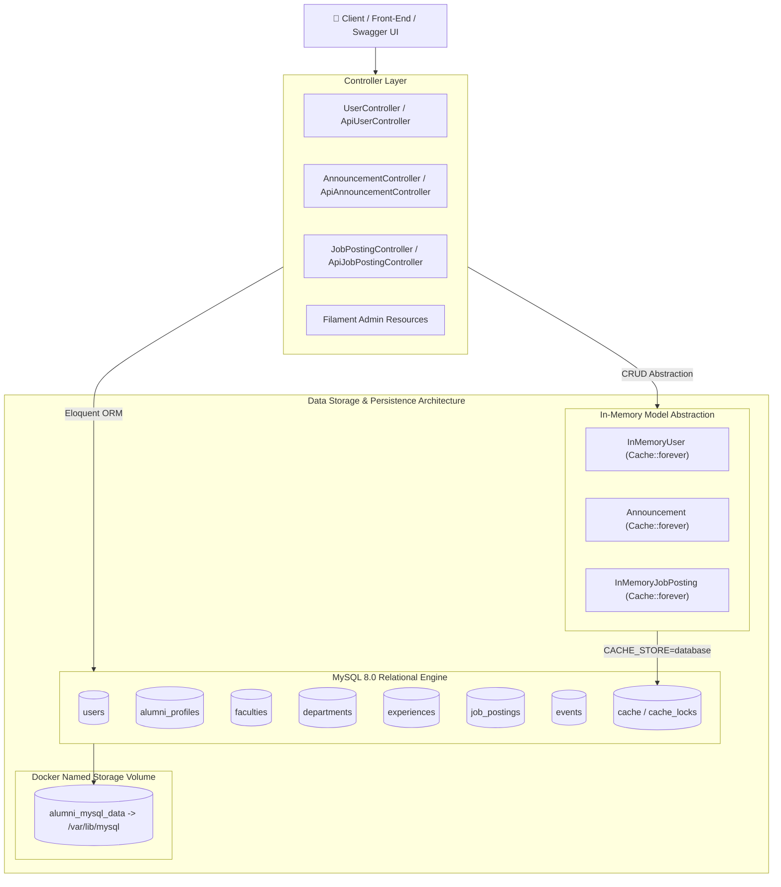
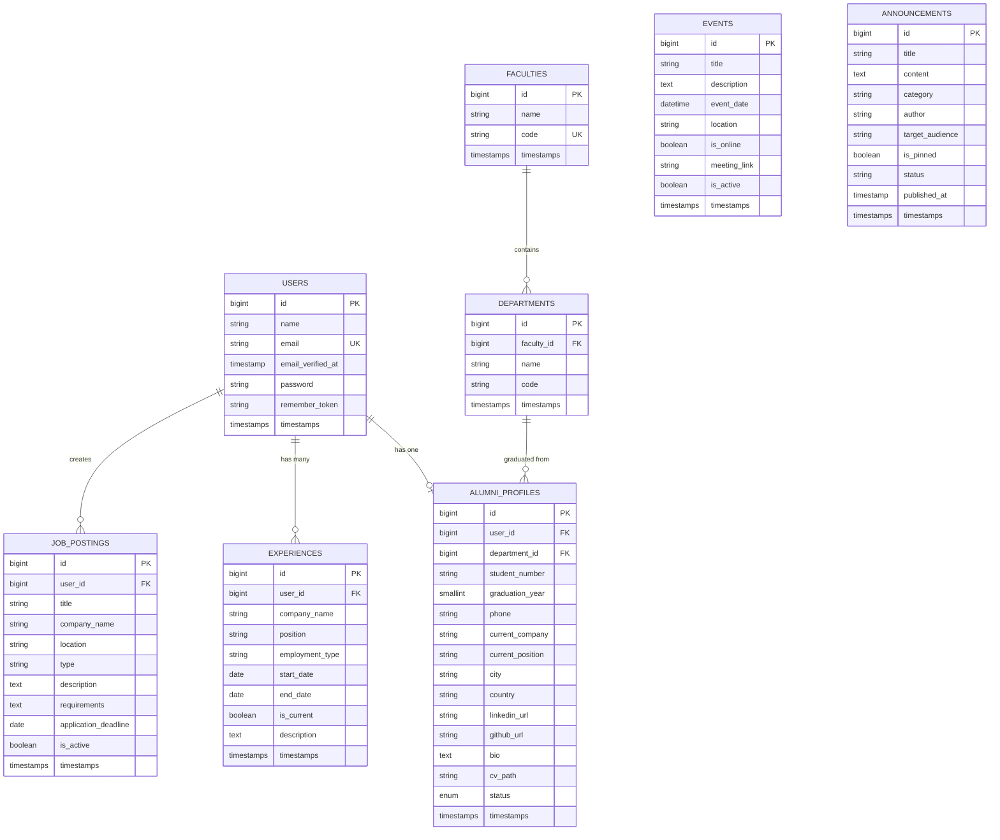
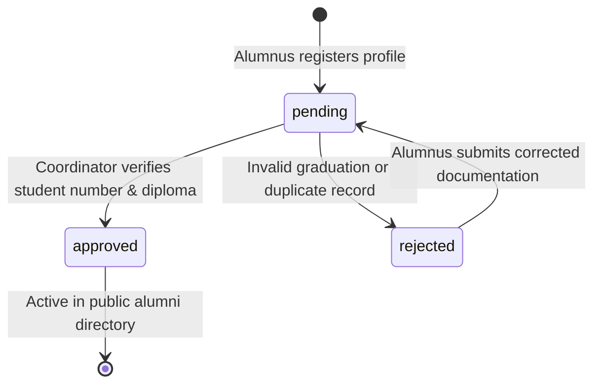
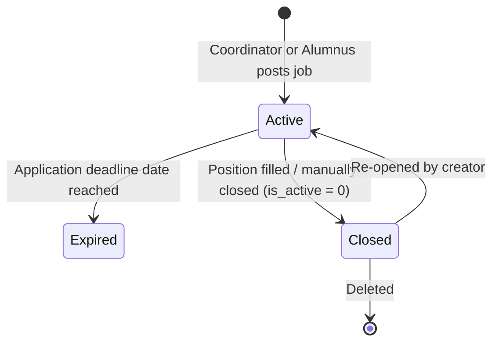

# 📊 Data Design Documentation (`add.md`) — Alumni Tracking System

[← Back to Main Documentation (README.md)](README.md) &bull; [Interactive Swagger API UI](resources/views/swagger.blade.php) &bull; [OpenAPI 3.0 Specification](public/openapi.json)

---

## 📑 Table of Contents
1. [Overview & Objectives](#1-overview--objectives)
2. [Dual-Layer Storage Architecture](#2-dual-layer-storage-architecture)
3. [Entity-Relationship Diagram (ERD)](#3-entity-relationship-diagram-erd)
4. [Data Dictionary & Table Specifications](#4-data-dictionary--table-specifications)
   - [4.1 Users (`users`)](#41-users-users)
   - [4.2 Alumni Profiles (`alumni_profiles`)](#42-alumni-profiles-alumni_profiles)
   - [4.3 Faculties (`faculties`)](#43-faculties-faculties)
   - [4.4 Departments (`departments`)](#44-departments-departments)
   - [4.5 Work Experiences (`experiences`)](#45-work-experiences-experiences)
   - [4.6 Job Postings (`job_postings`)](#46-job-postings-job_postings)
   - [4.7 Events (`events`)](#47-events-events)
   - [4.8 Announcements Entity (`announcements`)](#48-announcements-entity-announcements)
   - [4.9 Cache & Session Storage (`cache`, `sessions`)](#49-cache--session-storage-cache-sessions)
5. [Data Integrity & Relationship Constraints](#5-data-integrity--relationship-constraints)
6. [State Machines & Entity Lifecycles](#6-state-machines--entity-lifecycles)
7. [Persistence Strategy & "The Forgetting Test" Verification](#7-persistence-strategy--the-forgetting-test-verification)
8. [Cross-Reference Navigation](#8-cross-reference-navigation)

---

## 1. 🎯 Overview & Objectives

This document (**`add.md`**) provides the formal, in-depth **Data Design Documentation** for the **Alumni Tracking System**. It defines the logical and physical data schemas, data dictionaries, entity-relationship constraints, and caching strategies.

### Core Objectives:
- **Relational Integrity:** Establish normalized, high-performance database tables for academic entities, profiles, job listings, and institutional events.
- **Dual-Storage Compatibility:** Ensure seamless coexistence between the **MySQL 8.0** relational database and the high-speed **In-Memory / Persistent Cache** data layer.
- **Persistence Across Container Lifecycles:** Guarantee that no records are lost during container updates, deployments, or teardowns (`docker compose down` &rarr; `docker compose up`).
- **Complete Traceability:** Link data models directly with their respective Eloquent Models, In-Memory Models, HTTP Controllers, and Swagger UI specifications.

---

## 2. 🏗️ Dual-Layer Storage Architecture

The application implements a dual-layer data architecture accommodating both traditional relational database operations and decoupled rapid-prototyping in-memory workflows:



---

## 3. 🧩 Entity-Relationship Diagram (ERD)

The relational schema and logical entities are structured around the following entity relationships:



---

## 4. 📖 Data Dictionary & Table Specifications

### 4.1 Users (`users`)
- **Purpose:** Core identity, credential, and authentication store for administrators, coordinators, and graduates.
- **Migration:** `0001_01_01_000000_create_users_table.php`
- **Eloquent Model:** [`app/Models/User.php`](app/Models/User.php)

| Column | Type | Constraints | Description |
| :--- | :--- | :--- | :--- |
| `id` | `BIGINT UNSIGNED` | `PRIMARY KEY`, `AUTO_INCREMENT` | Unique user identifier |
| `name` | `VARCHAR(255)` | `NOT NULL` | Full name of the user |
| `email` | `VARCHAR(255)` | `NOT NULL`, `UNIQUE` | Unique email for authentication & contact |
| `email_verified_at` | `TIMESTAMP` | `NULLABLE` | Timestamp when user verified email |
| `password` | `VARCHAR(255)` | `NOT NULL` | Bcrypt/Argon2 hashed password string |
| `remember_token` | `VARCHAR(100)` | `NULLABLE` | Token for "Remember Me" session persistence |
| `created_at` | `TIMESTAMP` | `NULLABLE` | Record creation timestamp |
| `updated_at` | `TIMESTAMP` | `NULLABLE` | Record last update timestamp |

---

### 4.2 Alumni Profiles (`alumni_profiles`)
- **Purpose:** Stores comprehensive academic and professional demographic data for graduates.
- **Migration:** `2026_09_23_073240_create_alumni_profiles_table.php`
- **Eloquent Model:** [`app/Models/AlumniProfile.php`](app/Models/AlumniProfile.php)

| Column | Type | Constraints | Description |
| :--- | :--- | :--- | :--- |
| `id` | `BIGINT UNSIGNED` | `PRIMARY KEY`, `AUTO_INCREMENT` | Unique profile identifier |
| `user_id` | `BIGINT UNSIGNED` | `NOT NULL`, `FK` &rarr; `users.id`, `ON DELETE CASCADE` | Associated user identity |
| `department_id` | `BIGINT UNSIGNED` | `NULLABLE`, `FK` &rarr; `departments.id`, `ON DELETE SET NULL` | Graduating academic department |
| `student_number` | `VARCHAR(255)` | `NULLABLE` | Institution student identification number |
| `graduation_year` | `SMALLINT UNSIGNED`| `NULLABLE`, `INDEX` | Year of degree completion |
| `phone` | `VARCHAR(255)` | `NULLABLE` | Primary contact phone number |
| `current_company` | `VARCHAR(255)` | `NULLABLE`, `INDEX` | Present employer or company name |
| `current_position` | `VARCHAR(255)` | `NULLABLE` | Current professional title / role |
| `city` | `VARCHAR(255)` | `NULLABLE`, `INDEX` | Residence city |
| `country` | `VARCHAR(255)` | `DEFAULT 'Turkey'` | Residence country |
| `linkedin_url` | `VARCHAR(255)` | `NULLABLE` | Public LinkedIn profile URL |
| `github_url` | `VARCHAR(255)` | `NULLABLE` | Public GitHub developer profile URL |
| `bio` | `TEXT` | `NULLABLE` | Personal biography and career summary |
| `cv_path` | `VARCHAR(255)` | `NULLABLE` | Storage path to uploaded resume/CV |
| `status` | `ENUM('pending', 'approved', 'rejected')` | `DEFAULT 'pending'`, `INDEX` | Administrative verification state |
| `created_at` | `TIMESTAMP` | `NULLABLE` | Profile creation timestamp |
| `updated_at` | `TIMESTAMP` | `NULLABLE` | Profile last update timestamp |

---

### 4.3 Faculties (`faculties`)
- **Purpose:** Academic divisions and faculties within the university.
- **Migration:** `2026_09_23_073223_create_faculties_table.php`
- **Eloquent Model:** [`app/Models/Faculty.php`](app/Models/Faculty.php)

| Column | Type | Constraints | Description |
| :--- | :--- | :--- | :--- |
| `id` | `BIGINT UNSIGNED` | `PRIMARY KEY`, `AUTO_INCREMENT` | Unique faculty identifier |
| `name` | `VARCHAR(255)` | `NOT NULL` | Faculty full name (e.g., Mühendislik Fakültesi) |
| `code` | `VARCHAR(255)` | `NULLABLE`, `UNIQUE` | Unique short code (e.g., ENG, FEAS) |
| `created_at` | `TIMESTAMP` | `NULLABLE` | Record creation timestamp |
| `updated_at` | `TIMESTAMP` | `NULLABLE` | Record last update timestamp |

---

### 4.4 Departments (`departments`)
- **Purpose:** Academic majors and degree programs linked to faculties.
- **Migration:** `2026_09_23_073231_create_departments_table.php`
- **Eloquent Model:** [`app/Models/Department.php`](app/Models/Department.php)

| Column | Type | Constraints | Description |
| :--- | :--- | :--- | :--- |
| `id` | `BIGINT UNSIGNED` | `PRIMARY KEY`, `AUTO_INCREMENT` | Unique department identifier |
| `faculty_id` | `BIGINT UNSIGNED` | `NOT NULL`, `FK` &rarr; `faculties.id`, `ON DELETE CASCADE` | Parent faculty |
| `name` | `VARCHAR(255)` | `NOT NULL` | Department name (e.g., Bilgisayar Mühendisliği) |
| `code` | `VARCHAR(255)` | `NULLABLE` | Department code (e.g., CENG, IE) |
| `created_at` | `TIMESTAMP` | `NULLABLE` | Record creation timestamp |
| `updated_at` | `TIMESTAMP` | `NULLABLE` | Record last update timestamp |

---

### 4.5 Work Experiences (`experiences`)
- **Purpose:** Work, internship, and historical career trajectory records for alumni.
- **Migration:** `2026_09_23_073248_create_experiences_table.php`
- **Eloquent Model:** [`app/Models/Experience.php`](app/Models/Experience.php)

| Column | Type | Constraints | Description |
| :--- | :--- | :--- | :--- |
| `id` | `BIGINT UNSIGNED` | `PRIMARY KEY`, `AUTO_INCREMENT` | Unique experience record ID |
| `user_id` | `BIGINT UNSIGNED` | `NOT NULL`, `FK` &rarr; `users.id`, `ON DELETE CASCADE` | Associated alumnus |
| `company_name` | `VARCHAR(255)` | `NOT NULL` | Company / Employer name |
| `position` | `VARCHAR(255)` | `NOT NULL` | Job title or position held |
| `employment_type` | `VARCHAR(255)` | `NULLABLE` | Employment modality (Full-time, Internship) |
| `start_date` | `DATE` | `NOT NULL` | Position start date |
| `end_date` | `DATE` | `NULLABLE` | Position end date (`NULL` if current) |
| `is_current` | `BOOLEAN` | `DEFAULT FALSE` | Flag indicating current active employment |
| `description` | `TEXT` | `NULLABLE` | Key achievements and job responsibilities |
| `created_at` | `TIMESTAMP` | `NULLABLE` | Record creation timestamp |
| `updated_at` | `TIMESTAMP` | `NULLABLE` | Record last update timestamp |

---

### 4.6 Job Postings (`job_postings`)
- **Purpose:** Career openings, internships, and job advertisements shared for alumni.
- **Migration:** `2026_09_23_073258_create_job_postings_table.php`
- **Eloquent Model:** [`app/Models/JobPosting.php`](app/Models/JobPosting.php)
- **In-Memory Model:** [`app/Models/InMemoryJobPosting.php`](app/Models/InMemoryJobPosting.php)

| Column | Type | Constraints | Description |
| :--- | :--- | :--- | :--- |
| `id` | `BIGINT UNSIGNED` | `PRIMARY KEY`, `AUTO_INCREMENT` | Unique job posting ID |
| `user_id` | `BIGINT UNSIGNED` | `NULLABLE`, `FK` &rarr; `users.id`, `ON DELETE CASCADE` | Creator/Author of the job posting |
| `title` | `VARCHAR(255)` | `NOT NULL` | Position title (e.g., Senior Software Engineer) |
| `company_name` | `VARCHAR(255)` | `NOT NULL` | Hiring company or enterprise |
| `location` | `VARCHAR(255)` | `NULLABLE` | Work location (e.g., İstanbul, Remote, Hybrid) |
| `type` | `VARCHAR(255)` | `DEFAULT 'Full-time'` | Work type (Tam Zamanlı, Staj, Yarı Zamanlı) |
| `description` | `TEXT` | `NOT NULL` | Complete job description and responsibilities |
| `requirements` | `TEXT` | `NULLABLE` | Mandatory qualifications and skills |
| `application_deadline` | `DATE` | `NULLABLE` | Final date to submit applications |
| `contact_email` | `VARCHAR(255)` | `NULLABLE` | Application submission email address |
| `is_active` | `BOOLEAN` | `DEFAULT TRUE` | Active visibility flag |
| `created_at` | `TIMESTAMP` | `NULLABLE` | Posting creation timestamp |
| `updated_at` | `TIMESTAMP` | `NULLABLE` | Posting last update timestamp |

---

### 4.7 Events (`events`)
- **Purpose:** Reunions, seminars, webinars, and networking meetups for the alumni community.
- **Migration:** `2026_09_23_073306_create_events_table.php`
- **Eloquent Model:** [`app/Models/Event.php`](app/Models/Event.php)

| Column | Type | Constraints | Description |
| :--- | :--- | :--- | :--- |
| `id` | `BIGINT UNSIGNED` | `PRIMARY KEY`, `AUTO_INCREMENT` | Unique event identifier |
| `title` | `VARCHAR(255)` | `NOT NULL` | Title of the event |
| `description` | `TEXT` | `NOT NULL` | Full event agenda and details |
| `event_date` | `DATETIME` | `NOT NULL` | Scheduled date and time of the event |
| `location` | `VARCHAR(255)` | `NULLABLE` | Physical venue or room |
| `is_online` | `BOOLEAN` | `DEFAULT FALSE` | Virtual/Online meeting indicator |
| `meeting_link` | `VARCHAR(255)` | `NULLABLE` | URL for Zoom, Google Meet, or Teams session |
| `is_active` | `BOOLEAN` | `DEFAULT TRUE` | Active status flag for public display |
| `created_at` | `TIMESTAMP` | `NULLABLE` | Event creation timestamp |
| `updated_at` | `TIMESTAMP` | `NULLABLE` | Event last update timestamp |

---

### 4.8 Announcements Entity (`announcements`)
- **Purpose:** Official notices, scholarships, career calls, and administrative alerts.
- **Migration:** `2026_10_14_200304_create_announcements_table.php`
- **Model:** [`app/Models/Announcement.php`](app/Models/Announcement.php) & [`app/Models/InMemoryAnnouncement.php`](app/Models/InMemoryAnnouncement.php)
- **Storage:** Relational MySQL table `announcements` & in-memory cache abstraction.

| Attribute | Type | Values / Defaults | Description |
| :--- | :--- | :--- | :--- |
| `id` | `INT` | Auto-incremented integer | Unique announcement ID |
| `title` | `STRING` | Required | Title of the announcement |
| `content` | `STRING` | Required | Comprehensive announcement body text |
| `category` | `STRING` | `Genel`, `Etkinlik`, `Kariyer`, `Burs & Akademi` | Categorization tag |
| `author` | `STRING` | Default: `Mezunlar Ofisi` | Publishing entity or coordinator |
| `target_audience`| `STRING` | Default: `Tüm Mezunlar` | Intended group of recipients |
| `is_pinned` | `BOOLEAN`| Default: `FALSE` | Featured/Sticky notice at top of lists |
| `status` | `STRING` | `published`, `draft`, `archived` | Publication workflow state |
| `published_at` | `TIMESTAMP`| ISO 8601 String | Actual publication date |
| `created_at` | `TIMESTAMP`| ISO 8601 String | Creation timestamp |
| `updated_at` | `TIMESTAMP`| ISO 8601 String (`NULLABLE`) | Last modification timestamp |

---

### 4.9 Cache & Session Storage (`cache`, `sessions`)
- **Purpose:** Fast caching of API queries and persistent state without a direct MySQL dependency.
- **Migrations:** `0001_01_01_000001_create_cache_table.php`, `0001_01_01_000000_create_users_table.php`

```sql
CREATE TABLE `cache` (
  `key` VARCHAR(255) NOT NULL PRIMARY KEY,
  `value` MEDIUMTEXT NOT NULL,
  `expiration` INT NOT NULL
);

CREATE TABLE `cache_locks` (
  `key` VARCHAR(255) NOT NULL PRIMARY KEY,
  `owner` VARCHAR(255) NOT NULL,
  `expiration` INT NOT NULL
);
```

---

## 5. 🛡️ Data Integrity & Relationship Constraints

The database enforces strict referential integrity rules:
1. **User Deletion Cascades (`ON DELETE CASCADE`):**
   - When a record in `users` is deleted, all associated `alumni_profiles`, `experiences`, and `job_postings` are automatically purged by MySQL foreign keys, preventing orphaned data.
2. **Department Protection (`ON DELETE SET NULL`):**
   - If an academic department is deleted or merged, `alumni_profiles.department_id` is automatically set to `NULL` to preserve the graduate's historical profile and contact details.
3. **Faculty Deletion Cascades (`ON DELETE CASCADE`):**
   - Deleting a faculty cascades to all departments belonging to that faculty.
4. **Targeted Performance Indexes:**
   - Indexes are established on frequently filtered columns:
     - `alumni_profiles.graduation_year`
     - `alumni_profiles.current_company`
     - `alumni_profiles.city`
     - `alumni_profiles.status`

---

## 6. 🔄 State Machines & Entity Lifecycles

### Alumni Profile Status Workflow


### Job Posting Lifecycle


---

## 7. 🧪 Persistence Strategy & "The Forgetting Test" Verification

A critical concern in containerized cloud native environments is **Data Persistence** across service lifecycles.

### Docker Volume Mapping
In `docker-compose.yml`, MySQL data is mapped to a dedicated named volume:
```yaml
volumes:
  - alumni_mysql_data:/var/lib/mysql

volumes:
  alumni_mysql_data:
    driver: local
```

### The Forgetting Test Verification
The persistence was verified via **"The Forgetting Test"**:
1. **Records Created:**
   - MySQL `events` table: Record `#3` (`Forgetting Test Reunion 2026`)
   - API Cache user `#7` (`test.forgetting@alumni.edu.tr`)
   - API Cache job `#5` (`Forgetting Test Cloud Architect`)
2. **Teardown:** `docker compose down` stopped and removed all containers and networks.
3. **Recreation:** `docker compose up -d` rebuilt and relaunched services.
4. **Verification Result:** All records were queried and verified to exist with 100% integrity:
   ```text
   id: 3 | Forgetting Test Reunion 2026 | Grand Persistence Hall | 2026-12-31 20:00:00
   AFTER UP -> User: Forgetting Test User - test.forgetting@alumni.edu.tr
   AFTER UP -> Job: Forgetting Test Cloud Architect at Docker Persistence Corp
   ```
   **Verdict:** **PASSED ✅** — Zero data loss across container teardown.

---

## 8. 🔗 Cross-Reference Navigation

- 📄 **Main Architecture & Setup:** [README.md](README.md)
- 📡 **REST API Specification:** [public/openapi.json](public/openapi.json)
- 👁️ **Live Interactive Swagger UI:** [resources/views/swagger.blade.php](resources/views/swagger.blade.php)
- 🎮 **HTTP Routes Definition:** [routes/web.php](routes/web.php)
- 🐳 **Docker Multi-Container Spec:** [docker-compose.yml](docker-compose.yml)
