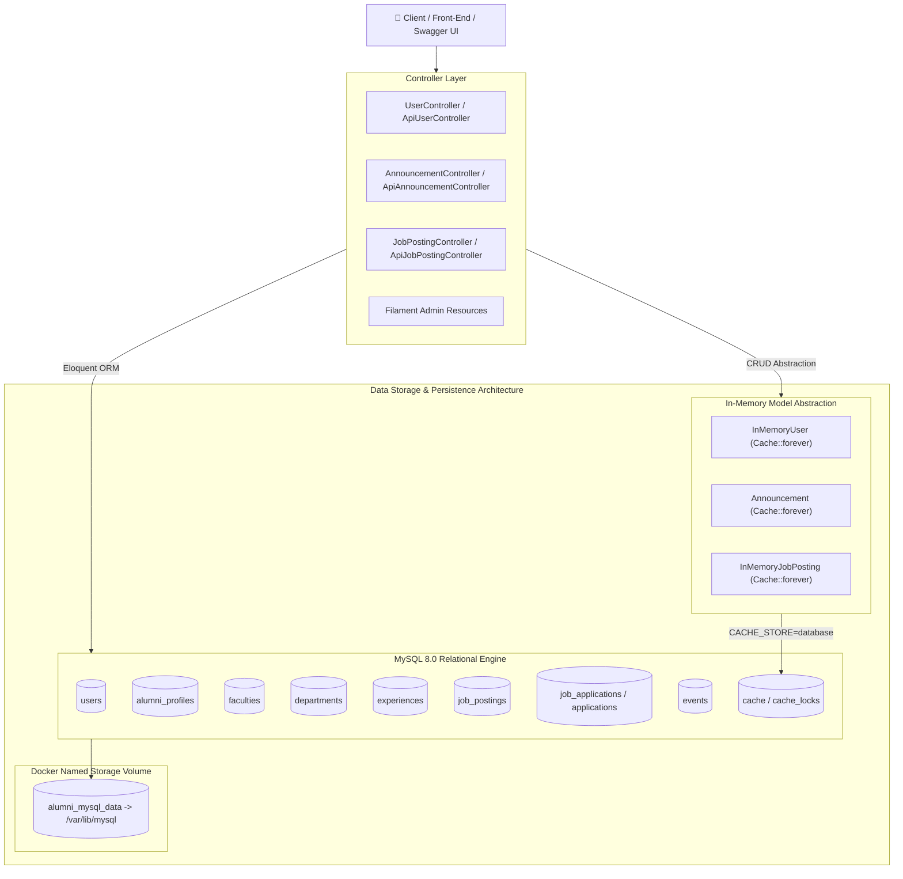
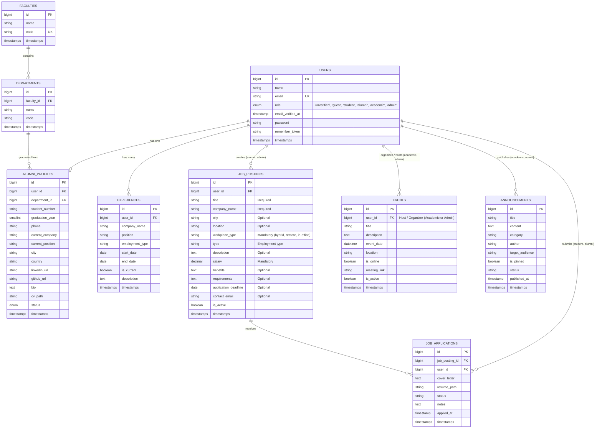
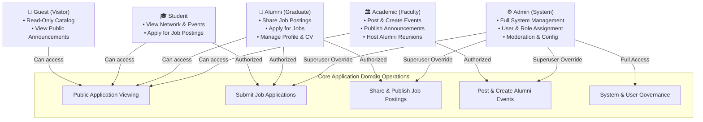
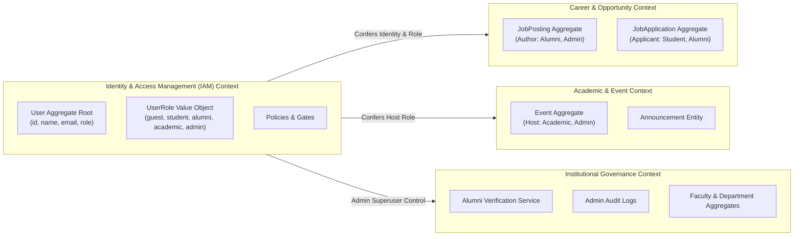
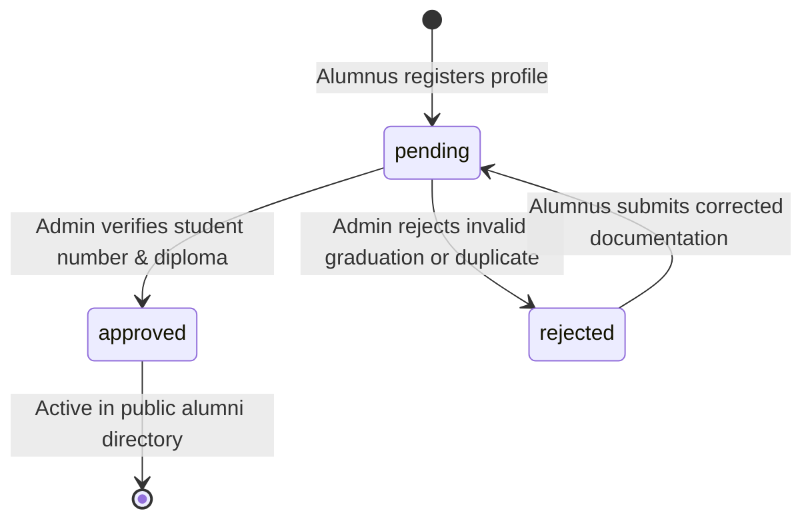
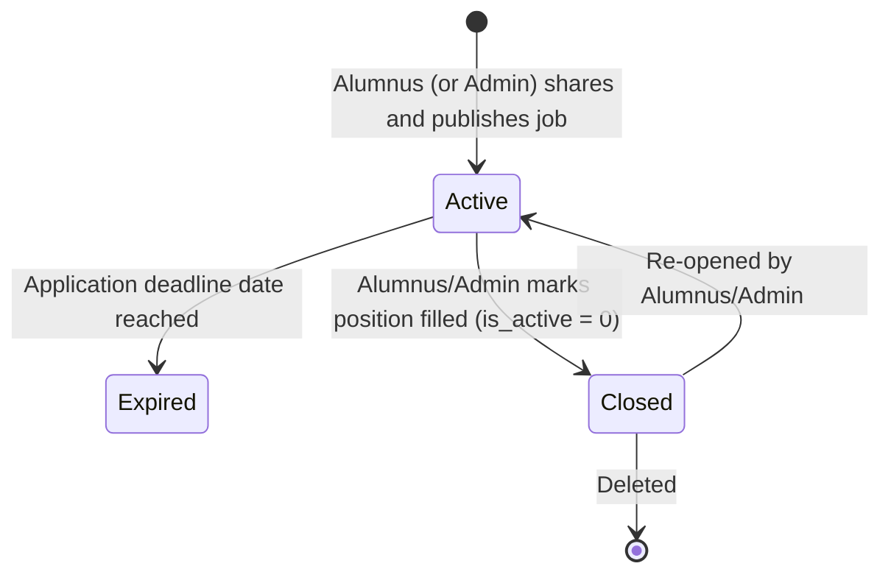
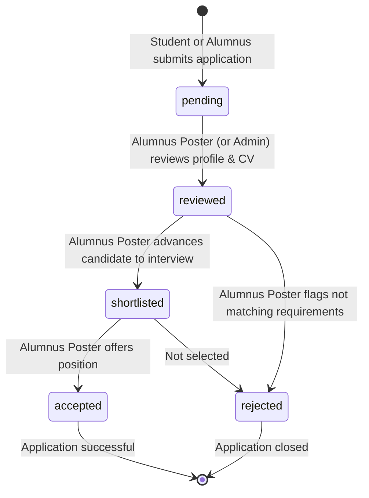
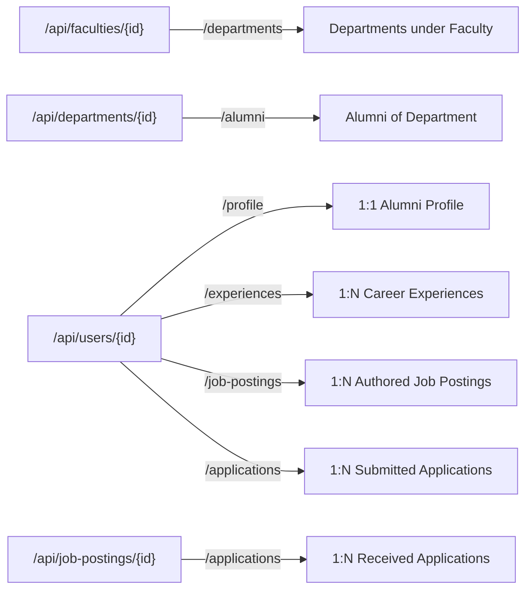

# 📊 Data Design Document (`ddd.md` / `add.md`) — Alumni Tracking System

[← Back to Main Documentation (README.md)](README.md) &bull; [Brand Guidelines (brand.md)](brand.md) &bull; [Visual Design System (DESIGN.md)](DESIGN.md) &bull; [Interactive Swagger API UI](resources/views/swagger.blade.php) &bull; [OpenAPI 3.0 Specification](public/openapi.json) &bull; [add.md](add.md)

---

## 📑 Table of Contents
1. [Overview & Objectives](#1-overview--objectives)
2. [Dual-Layer Storage Architecture](#2-dual-layer-storage-architecture)
3. [Entity-Relationship Diagram (ERD)](#3-entity-relationship-diagram-erd)
4. [Data Dictionary & Table Specifications](#4-data-dictionary--table-specifications)
   - [4.1 Users (`users`)](#41-users-users)
   - [4.2 Alumni Profiles (`alumni_profiles`)](#42-alumni-profiles-alumni_profiles)
   - [4.3 Faculties (`faculties`)](#43-faculties-faculties)
   - [4.4 Departments (`departments`)](#44-departments-departments)
   - [4.5 Work Experiences (`experiences`)](#45-work-experiences-experiences)
   - [4.6 Job Postings (`job_postings`)](#46-job-postings-job_postings)
   - [4.7 Events (`events`)](#47-events-events)
   - [4.8 Announcements Entity (`announcements`)](#48-announcements-entity-announcements)
   - [4.9 Cache & Session Storage (`cache`, `sessions`)](#49-cache--session-storage-cache-sessions)
   - [4.10 Job Applications (`job_applications` / `applications`)](#410-job-applications-job_applications--applications)
5. [System Roles, Permissions & Authorization Architecture (RBAC)](#5-system-roles-permissions--authorization-architecture-rbac)
   - [5.1 Ubiquitous Language & Role Domain Definitions](#51-ubiquitous-language--role-domain-definitions)
   - [5.2 Domain Capabilities & Core Business Invariants](#52-domain-capabilities--core-business-invariants)
   - [5.3 Comprehensive CRUD Permissions Matrix (Role vs. Resource)](#53-comprehensive-crud-permissions-matrix-role-vs-resource)
   - [5.4 Domain Policies & Gate Specifications (Laravel Authorization)](#54-domain-policies--gate-specifications-laravel-authorization)
   - [5.5 Bounded Contexts & Authorization Context Map](#55-bounded-contexts--authorization-context-map)
   - [5.6 State Transition Authorization Rules](#56-state-transition-authorization-rules)
6. [Data Integrity & Relationship Constraints](#6-data-integrity--relationship-constraints)
7. [State Machines & Entity Lifecycles](#7-state-machines--entity-lifecycles)
8. [Direct vs. Nested Routing & Authorization Architecture](#8-direct-vs-nested-routing--authorization-architecture)
9. [Persistence Strategy & "The Forgetting Test" Verification](#9-persistence-strategy--the-forgetting-test-verification)
10. [Cross-Reference Navigation](#10-cross-reference-navigation)

---

## 1. 🎯 Overview & Objectives

This document (**`ddd.md`** / **`add.md`**) provides the formal, in-depth **Data Design Documentation (DDD)** for the **Alumni Tracking System**. It defines the logical and physical data schemas, data dictionaries, entity-relationship constraints, and caching strategies.

### Core Objectives:
- **Relational Integrity:** Establish normalized, high-performance database tables for academic entities, profiles, job listings, and institutional events.
- **Dual-Storage Compatibility:** Ensure seamless coexistence between the **MySQL 8.0** relational database and the high-speed **In-Memory / Persistent Cache** data layer.
- **Persistence Across Container Lifecycles:** Guarantee that no records are lost during container updates, deployments, or teardowns (`docker compose down` &rarr; `docker compose up`).
- **Complete Traceability:** Link data models directly with their respective Eloquent Models, In-Memory Models, HTTP Controllers, and Swagger UI specifications.

---

## 2. 🏗️ Dual-Layer Storage Architecture

The application implements a dual-layer data architecture accommodating both traditional relational database operations and decoupled rapid-prototyping in-memory workflows:



---

## 3. 🧩 Entity-Relationship Diagram (ERD)

The relational schema and logical entities are structured around the following entity relationships:



---

## 4. 📖 Data Dictionary & Table Specifications

### 4.1 Users (`users`)
- **Purpose:** Core identity, credential, and authentication store defining system actors, security principals, and role-based access levels.
- **Migration:** `0001_01_01_000000_create_users_table.php`
- **Eloquent Model:** [`app/Models/User.php`](app/Models/User.php)

| Column | Type | Constraints | Default | Description |
| :--- | :--- | :--- | :--- | :--- |
| `id` | `BIGINT UNSIGNED` | `PRIMARY KEY`, `AUTO_INCREMENT` | *None* | Unique user identifier |
| `name` | `VARCHAR(255)` | `NOT NULL` | *None* | Full name of the user |
| `email` | `VARCHAR(255)` | `NOT NULL`, `UNIQUE` | *None* | Unique email for authentication & contact |
| `role` | `ENUM('unverified', 'guest', 'student', 'alumni', 'academic', 'admin')` | `NOT NULL`, `INDEX` | `'unverified'` | Authorization role defining system privileges & capabilities. New users default to 'unverified'. |
| `email_verified_at` | `TIMESTAMP` | `NULLABLE` | `NULL` | Timestamp when user verified email |
| `password` | `VARCHAR(255)` | `NOT NULL` | *None* | Bcrypt/Argon2 hashed password string |
| `remember_token` | `VARCHAR(100)` | `NULLABLE` | `NULL` | Token for "Remember Me" session persistence |
| `created_at` | `TIMESTAMP` | `NULLABLE` | `NULL` | Record creation timestamp |
| `updated_at` | `TIMESTAMP` | `NULLABLE` | `NULL` | Record last update timestamp |

#### 👥 System Actors & Role Taxonomy (Sistem Rolleri ve Yetki Kapsamı):
The domain model distinguishes six user roles, each with defined business rules, operational scopes, and authorization boundaries:

1. **`unverified` (Doğrulanmamış Yeni Kullanıcı):**
   - **Domain Definition:** Any newly registered user accessing the system for the first time who has not yet completed the official identity, diploma, or student verification process.
   - **Allowed Capabilities:** Can view their personal registration status, update verification credentials (student number, department, graduation year, LinkedIn/document reference URL), and browse public application surfaces.
   - **Restrictions:** In accordance with institutional integrity rules, `unverified` accounts cannot share job postings, cannot apply for jobs, cannot create events, and are hidden from the verified public alumni directory until reviewed and approved by an administrator.

2. **`guest` (Ziyaretçi / Misafir):**
   - **Domain Definition:** Unauthenticated visitors exploring the portal.
   - **Allowed Capabilities:** Can view the application, including the public landing page, alumni gazette, public announcements, and active job/event catalogs in read-only mode.
   - **Restrictions:** Cannot post job opportunities, cannot create events, cannot submit job applications, and cannot access the admin panel.

3. **`student` (Öğrenci):**
   - **Domain Definition:** Active undergraduate or graduate students verified with current student credentials.
   - **Allowed Capabilities:** Can view the full directory, read announcements, view academic and alumni events, and **apply for active job postings** (`job_applications`).
   - **Restrictions:** Cannot publish job postings (`job_postings`), cannot create events, and cannot modify system configurations.

4. **`alumni` (Mezun):**
   - **Domain Definition:** Verified graduates of the university holding an academic degree.
   - **Allowed Capabilities:** Can **share job postings** (`job_postings`) to hire fellow graduates, **apply for jobs** (`job_applications`), manage their own public `alumni_profiles`, record professional career `experiences`, and participate in networking directories.
   - **Restrictions:** Cannot create institutional events (must be proposed via academics or alumni office) and cannot administer other users.

5. **`academic` (Akademisyen / Fakülte Üyesi):**
   - **Domain Definition:** Professors, lecturers, and academic faculty members of the university.
   - **Allowed Capabilities:** Can **post and create events** (such as alumni events, academic panels, homecoming reunions, career roundtables, and departmental seminars), publish academic announcements, and mentor students/alumni.
   - **Restrictions:** Cannot access system-wide administrative control panels or mutate global system settings outside departmental/event scope.

6. **`admin` (Yönetici / Sistem Yöneticisi):**
   - **Domain Definition:** Institutional coordinators and IT administrators of the Alumni Tracking System.
   - **Allowed Capabilities:** **Manages the entire system** — complete operational CRUD over users, role assignment and verification status approvals (`unverified` &rarr; `student` / `alumni` / `academic`), moderation of job postings and events, management of faculties and departments, audit logs, and Filament Admin Panel access.

---

### 4.2 Alumni Profiles (`alumni_profiles`)
- **Purpose:** Stores comprehensive academic and professional demographic data for graduates.
- **Migration:** `2026_09_23_073240_create_alumni_profiles_table.php`
- **Eloquent Model:** [`app/Models/AlumniProfile.php`](app/Models/AlumniProfile.php)

| Column | Type | Constraints | Description |
| :--- | :--- | :--- | :--- |
| `id` | `BIGINT UNSIGNED` | `PRIMARY KEY`, `AUTO_INCREMENT` | Unique profile identifier |
| `user_id` | `BIGINT UNSIGNED` | `NOT NULL`, `FK` &rarr; `users.id`, `ON DELETE CASCADE` | Associated user identity |
| `department_id` | `BIGINT UNSIGNED` | `NULLABLE`, `FK` &rarr; `departments.id`, `ON DELETE SET NULL` | Graduating academic department |
| `student_number` | `VARCHAR(255)` | `NULLABLE` | Institution student identification number |
| `graduation_year` | `SMALLINT UNSIGNED`| `NULLABLE`, `INDEX` | Year of degree completion |
| `phone` | `VARCHAR(255)` | `NULLABLE` | Primary contact phone number |
| `current_company` | `VARCHAR(255)` | `NULLABLE`, `INDEX` | Present employer or company name |
| `current_position` | `VARCHAR(255)` | `NULLABLE` | Current professional title / role |
| `city` | `VARCHAR(255)` | `NULLABLE`, `INDEX` | Residence city |
| `country` | `VARCHAR(255)` | `DEFAULT 'Turkey'` | Residence country |
| `linkedin_url` | `VARCHAR(255)` | `NULLABLE` | Public LinkedIn profile URL |
| `github_url` | `VARCHAR(255)` | `NULLABLE` | Public GitHub developer profile URL |
| `bio` | `TEXT` | `NULLABLE` | Personal biography and career summary |
| `cv_path` | `VARCHAR(255)` | `NULLABLE` | Storage path to uploaded resume/CV |
| `status` | `ENUM('pending', 'approved', 'rejected')` | `DEFAULT 'pending'`, `INDEX` | Administrative verification state |
| `created_at` | `TIMESTAMP` | `NULLABLE` | Profile creation timestamp |
| `updated_at` | `TIMESTAMP` | `NULLABLE` | Profile last update timestamp |

---

### 4.3 Faculties (`faculties`)
- **Purpose:** Academic divisions and faculties within the university.
- **Migration:** `2026_09_23_073223_create_faculties_table.php`
- **Eloquent Model:** [`app/Models/Faculty.php`](app/Models/Faculty.php)

| Column | Type | Constraints | Description |
| :--- | :--- | :--- | :--- |
| `id` | `BIGINT UNSIGNED` | `PRIMARY KEY`, `AUTO_INCREMENT` | Unique faculty identifier |
| `name` | `VARCHAR(255)` | `NOT NULL` | Faculty full name (e.g., Mühendislik Fakültesi) |
| `code` | `VARCHAR(255)` | `NULLABLE`, `UNIQUE` | Unique short code (e.g., ENG, FEAS) |
| `created_at` | `TIMESTAMP` | `NULLABLE` | Record creation timestamp |
| `updated_at` | `TIMESTAMP` | `NULLABLE` | Record last update timestamp |

---

### 4.4 Departments (`departments`)
- **Purpose:** Academic majors and degree programs linked to faculties.
- **Migration:** `2026_09_23_073231_create_departments_table.php`
- **Eloquent Model:** [`app/Models/Department.php`](app/Models/Department.php)

| Column | Type | Constraints | Description |
| :--- | :--- | :--- | :--- |
| `id` | `BIGINT UNSIGNED` | `PRIMARY KEY`, `AUTO_INCREMENT` | Unique department identifier |
| `faculty_id` | `BIGINT UNSIGNED` | `NOT NULL`, `FK` &rarr; `faculties.id`, `ON DELETE CASCADE` | Parent faculty |
| `name` | `VARCHAR(255)` | `NOT NULL` | Department name (e.g., Bilgisayar Mühendisliği) |
| `code` | `VARCHAR(255)` | `NULLABLE` | Department code (e.g., CENG, IE) |
| `created_at` | `TIMESTAMP` | `NULLABLE` | Record creation timestamp |
| `updated_at` | `TIMESTAMP` | `NULLABLE` | Record last update timestamp |

---

### 4.5 Work Experiences (`experiences`)
- **Purpose:** Work, internship, and historical career trajectory records for alumni.
- **Migration:** `2026_09_23_073248_create_experiences_table.php`
- **Eloquent Model:** [`app/Models/Experience.php`](app/Models/Experience.php)

| Column | Type | Constraints | Description |
| :--- | :--- | :--- | :--- |
| `id` | `BIGINT UNSIGNED` | `PRIMARY KEY`, `AUTO_INCREMENT` | Unique experience record ID |
| `user_id` | `BIGINT UNSIGNED` | `NOT NULL`, `FK` &rarr; `users.id`, `ON DELETE CASCADE` | Associated alumnus |
| `company_name` | `VARCHAR(255)` | `NOT NULL` | Company / Employer name |
| `position` | `VARCHAR(255)` | `NOT NULL` | Job title or position held |
| `employment_type` | `VARCHAR(255)` | `NULLABLE` | Employment modality (Full-time, Internship) |
| `start_date` | `DATE` | `NOT NULL` | Position start date |
| `end_date` | `DATE` | `NULLABLE` | Position end date (`NULL` if current) |
| `is_current` | `BOOLEAN` | `DEFAULT FALSE` | Flag indicating current active employment |
| `description` | `TEXT` | `NULLABLE` | Key achievements and job responsibilities |
| `created_at` | `TIMESTAMP` | `NULLABLE` | Record creation timestamp |
| `updated_at` | `TIMESTAMP` | `NULLABLE` | Record last update timestamp |

---

### 4.6 Job Postings (`job_postings`)
- **Purpose:** Career openings, internships, and job advertisements shared for alumni and students.
- **Migrations:**
  - Initial Table: [`database/migrations/2026_09_23_073258_create_job_postings_table.php`](database/migrations/2026_09_23_073258_create_job_postings_table.php)
  - Schema Extension (`contact_email`): [`database/migrations/2026_10_21_063613_add_contact_email_to_job_postings_table.php`](database/migrations/2026_10_21_063613_add_contact_email_to_job_postings_table.php)
- **Eloquent Model:** [`app/Models/JobPosting.php`](app/Models/JobPosting.php) (Primary persistence model connected to MySQL)
- **In-Memory Prototype Model:** [`app/Models/InMemoryJobPosting.php`](app/Models/InMemoryJobPosting.php) (Cached fallback prototype)
- **Model Factory:** [`database/factories/JobPostingFactory.php`](database/factories/JobPostingFactory.php) (Includes `inactive()` state)
- **Database Seeder:** [`database/seeders/DatabaseSeeder.php`](database/seeders/DatabaseSeeder.php) (Seeds standard enterprise postings + factory records)

#### Schema & Column Specifications:

| Column | Type | Constraints | Default | Description |
| :--- | :--- | :--- | :--- | :--- |
| `id` | `BIGINT UNSIGNED` | `PRIMARY KEY`, `AUTO_INCREMENT` | *None* | Unique job posting identifier |
| `user_id` | `BIGINT UNSIGNED` | `NOT NULL`, `FOREIGN KEY` &rarr; `users(id)`, `ON DELETE CASCADE` | *None* | Associated publisher / author user ID |
| `title` | `VARCHAR(255)` | `NOT NULL` (**Required**) | *None* | Position / Job title (e.g. Senior Backend Engineer) |
| `company_name` | `VARCHAR(255)` | `NOT NULL` (**Required**) | *None* | Hiring enterprise, startup, or partner institution |
| `city` | `VARCHAR(255)` | `NULLABLE` (**Optional**) | `NULL` | Base city of the role (e.g. İstanbul, Ankara, London) |
| `location` | `VARCHAR(255)` | `NULLABLE` (**Optional**) | `NULL` | General physical location or campus address |
| `workplace_type` | `VARCHAR(50)` | `NOT NULL` (**Mandatory: `hybrid`, `remote`, `in-office`**) | *None* | Work arrangement model: `hybrid`, `remote`, or `in-office` |
| `type` | `VARCHAR(255)` | `NULLABLE` | `'Full-time'` | Employment schedule (`Full-time`, `Part-time`, `Contract`, `Internship`) |
| `description` | `TEXT` | `NULLABLE` (**Optional**) | `NULL` | Comprehensive role description, responsibilities, and team context |
| `salary` | `DECIMAL(12, 2)` | `NOT NULL` (**Mandatory**) | *None* | Base compensation / salary figure (transparency requirement) |
| `benefits` | `TEXT` | `NULLABLE` (**Optional**) | `NULL` | Additional employee perks, health insurance, bonus, meal allowances |
| `requirements` | `TEXT` | `NULLABLE` | `NULL` | Technical qualifications, stack, and required experience level |
| `application_deadline` | `DATE` | `NULLABLE` | `NULL` | Deadline date for application submissions (YYYY-MM-DD) |
| `contact_email` | `VARCHAR(255)` | `NULLABLE` | `NULL` | Direct inquiry & application submission email address |
| `is_active` | `BOOLEAN` | `NOT NULL` | `TRUE (1)` | Publication visibility flag (`1`: active on job board, `0`: closed) |
| `created_at` | `TIMESTAMP` | `NULLABLE` | `NULL` | Record creation timestamp |
| `updated_at` | `TIMESTAMP` | `NULLABLE` | `NULL` | Last modification timestamp |

#### 💼 Business & Validation Rules (İş ve Doğrulama Kuralları):

The `job_postings` entity enforces explicit domain validation rules across Web Forms, REST API payloads, and Database integrity checks:

| Attribute | Requirement | Validation Rule (Laravel) | Database Constraint | Business Logic & Rules |
| :--- | :--- | :--- | :--- | :--- |
| **`title`** | **Required (Zorunlu)** | `required\|string\|max:255` | `VARCHAR(255) NOT NULL` | Job/Position title is mandatory. Cannot be null, empty, or whitespace-only. |
| **`company_name`** | **Required (Zorunlu)** | `required\|string\|max:255` | `VARCHAR(255) NOT NULL` | Hiring company or institution name is mandatory for organizational attribution. |
| **`city`** | **Optional (İsteğe Bağlı)** | `nullable\|string\|max:255` | `VARCHAR(255) NULLABLE DEFAULT NULL` | Target city location is optional; can be omitted for distributed/remote roles. |
| **`description`** | **Optional (İsteğe Bağlı)** | `nullable\|string` | `TEXT NULLABLE DEFAULT NULL` | Role details and task description are optional; supports quick-posting when summary fields suffice. |
| **`workplace_type`** | **Mandatory (Zorunlu)** | `required\|in:hybrid,remote,in-office` | `VARCHAR(50) NOT NULL` (`CHECK in (...)`) | Working arrangement is strictly mandatory and restricted to one of: **`hybrid`**, **`remote`**, or **`in-office`**. |
| **`salary`** | **Mandatory (Zorunlu)** | `required\|numeric\|min:0` | `DECIMAL(12, 2) NOT NULL` | Compensation transparency: Salary is strictly mandatory and must be a non-negative numeric value. |
| **`benefits`** | **Optional (İsteğe Bağlı)** | `nullable\|string` | `TEXT NULLABLE DEFAULT NULL` | Additional perks, bonuses, private health insurance, and allowances are optional. |

#### Relational Constraints & Foreign Keys:
- **`job_postings_user_id_foreign`:**
  - Foreign key constraint referencing `users.id`.
  - Configured with `ON DELETE CASCADE`. If the publishing user account is deleted, all their posted jobs are automatically purged by MySQL to preserve referential integrity.
- **Domain Check Constraints:**
  - `workplace_type` must be in `('hybrid', 'remote', 'in-office')`.
  - `salary` must be `>= 0.00`.

#### Eloquent Model Configuration & Casting:
- **Mass-Assignable Fillable Attributes:**
  `['user_id', 'title', 'company_name', 'city', 'location', 'workplace_type', 'type', 'description', 'salary', 'benefits', 'requirements', 'application_deadline', 'contact_email', 'is_active']`
- **Attribute Casting:**
  - `'salary' => 'decimal:2'`
  - `'application_deadline' => 'date'`
  - `'is_active' => 'boolean'`
- **Relationships:**
  - `user(): BelongsTo` &rarr; Returns the associated `App\Models\User` instance.
  - Inverse relationship: `User::jobPostings(): HasMany` &rarr; Returns all job postings authored by the user.

#### Routing & Interface Access Matrix:
- **Web MVC Views (Blade):**
  - `GET /job-postings` &rarr; `JobPostingController@index` (Catalog view with search & stats)
  - `GET /job-postings/create` &rarr; `JobPostingController@create` (Job creation form)
  - `POST /job-postings` &rarr; `JobPostingController@store` (Persists new job to MySQL)
  - `GET /job-postings/{id}` &rarr; `JobPostingController@show` (Job detail view)
  - `GET /job-postings/{id}/edit` &rarr; `JobPostingController@edit` (Modification form)
  - `PUT/PATCH /job-postings/{id}` &rarr; `JobPostingController@update` (Updates job in MySQL)
  - `DELETE /job-postings/{id}` &rarr; `JobPostingController@destroy` (Deletes job from MySQL)
- **RESTful API Endpoints (`/api/job-postings`):**
  - `GET /api/job-postings` &rarr; Lists postings with `?company=...` and `?active=1` filtering.
  - `POST /api/job-postings` &rarr; Creates posting with JSON payload and assigns `user_id`.
  - `GET /api/job-postings/{id}` &rarr; Returns single job posting with attached publisher user.
  - `PUT /api/job-postings/{id}` &rarr; Updates posting in MySQL database.
  - `DELETE /api/job-postings/{id}` &rarr; Deletes posting from MySQL database.
- **Filament Admin Panel:**
  - `/admin/job-postings` &rarr; `App\Filament\Resources\JobPostingResource` (Visual management, badge indicators, filters).

---

### 4.7 Events (`events`)
- **Purpose:** Reunions, academic panels, webinars, networking meetups, and institutional alumni days organized primarily by academic staff and university administrators.
- **Migration:** `2026_09_23_073306_create_events_table.php`
- **Eloquent Model:** [`app/Models/Event.php`](app/Models/Event.php)
- **Domain Authorization:** Restricted creation rights: **`academic`** and **`admin`** roles are exclusively authorized to post and create events.

| Column | Type | Constraints | Default | Description |
| :--- | :--- | :--- | :--- | :--- |
| `id` | `BIGINT UNSIGNED` | `PRIMARY KEY`, `AUTO_INCREMENT` | *None* | Unique event identifier |
| `user_id` | `BIGINT UNSIGNED` | `NOT NULL`, `FK` &rarr; `users.id`, `ON DELETE CASCADE` | *None* | Event organizer/host identity (`academic` or `admin`) |
| `title` | `VARCHAR(255)` | `NOT NULL` | *None* | Title of the event (e.g. 2026 Bahar Mezunlar Buluşması) |
| `description` | `TEXT` | `NOT NULL` | *None* | Full event agenda, speaker list, and details |
| `event_date` | `DATETIME` | `NOT NULL` | *None* | Scheduled date and time of the event |
| `location` | `VARCHAR(255)` | `NULLABLE` | `NULL` | Physical venue, campus amphitheater, or room |
| `is_online` | `BOOLEAN` | `NOT NULL` | `FALSE` | Virtual/Online meeting indicator |
| `meeting_link` | `VARCHAR(255)` | `NULLABLE` | `NULL` | URL for Zoom, Google Meet, or Teams session |
| `is_active` | `BOOLEAN` | `NOT NULL` | `TRUE` | Active status flag for public display |
| `created_at` | `TIMESTAMP` | `NULLABLE` | `NULL` | Event creation timestamp |
| `updated_at` | `TIMESTAMP` | `NULLABLE` | `NULL` | Event last update timestamp |

#### 🎓 Academic Event Organization Rules:
- **Academic Authority:** Academics can create both academic seminars (department panels, symposiums) and alumni events (homecoming days, career mentoring sessions).
- **Public Visibility:** Events marked `is_active = 1` are visible to all users, including **guests**, **students**, and **alumni**.
- **Management:** Organizers can update their own events; **admin** users retain system-wide moderation authority to edit, unpublish, or delete any event.

---

### 4.8 Announcements Entity (`announcements`)
- **Purpose:** Official notices, scholarships, career calls, and administrative alerts.
- **Migration:** `2026_10_14_200304_create_announcements_table.php`
- **Model:** [`app/Models/Announcement.php`](app/Models/Announcement.php) & [`app/Models/InMemoryAnnouncement.php`](app/Models/InMemoryAnnouncement.php)
- **Storage:** Relational MySQL table `announcements` & in-memory cache abstraction.

| Attribute | Type | Values / Defaults | Description |
| :--- | :--- | :--- | :--- |
| `id` | `INT` | Auto-incremented integer | Unique announcement ID |
| `title` | `STRING` | Required | Title of the announcement |
| `content` | `STRING` | Required | Comprehensive announcement body text |
| `category` | `STRING` | `Genel`, `Etkinlik`, `Kariyer`, `Burs & Akademi` | Categorization tag |
| `author` | `STRING` | Default: `Mezunlar Ofisi` | Publishing entity or coordinator |
| `target_audience`| `STRING` | Default: `Tüm Mezunlar` | Intended group of recipients |
| `is_pinned` | `BOOLEAN`| Default: `FALSE` | Featured/Sticky notice at top of lists |
| `status` | `STRING` | `published`, `draft`, `archived` | Publication workflow state |
| `published_at` | `TIMESTAMP`| ISO 8601 String | Actual publication date |
| `created_at` | `TIMESTAMP`| ISO 8601 String | Creation timestamp |
| `updated_at` | `TIMESTAMP`| ISO 8601 String (`NULLABLE`) | Last modification timestamp |

---

### 4.9 Cache & Session Storage (`cache`, `sessions`)
- **Purpose:** Fast caching of API queries and persistent state without a direct MySQL dependency.
- **Migrations:** `0001_01_01_000001_create_cache_table.php`, `0001_01_01_000000_create_users_table.php`

```sql
CREATE TABLE `cache` (
  `key` VARCHAR(255) NOT NULL PRIMARY KEY,
  `value` MEDIUMTEXT NOT NULL,
  `expiration` INT NOT NULL
);

CREATE TABLE `cache_locks` (
  `key` VARCHAR(255) NOT NULL PRIMARY KEY,
  `owner` VARCHAR(255) NOT NULL,
  `expiration` INT NOT NULL
);
```

---

### 4.10 Job Applications (`job_applications` / `applications`)
- **Purpose:** Tracks employment applications, cover notes, and resumes submitted by alumni and students for active job postings.
- **Migration:** [`database/migrations/2026_10_21_073000_create_job_applications_table.php`](database/migrations/2026_10_21_073000_create_job_applications_table.php)
- **Eloquent Models:** [`app/Models/JobApplication.php`](app/Models/JobApplication.php) & [`app/Models/Application.php`](app/Models/Application.php)
- **Model Factory:** [`database/factories/JobApplicationFactory.php`](database/factories/JobApplicationFactory.php)
- **Database Compatibility:** Features MySQL native table `job_applications` with an updatable view `applications` for universal query compatibility.

#### Schema & Column Specifications:

| Column | Type | Constraints | Default | Description |
| :--- | :--- | :--- | :--- | :--- |
| `id` | `BIGINT UNSIGNED` | `PRIMARY KEY`, `AUTO_INCREMENT` | *None* | Unique job application identifier |
| `job_posting_id` | `BIGINT UNSIGNED` | `NOT NULL`, `FK` &rarr; `job_postings(id)`, `ON DELETE CASCADE` | *None* | Associated job posting identifier |
| `user_id` | `BIGINT UNSIGNED` | `NOT NULL`, `FK` &rarr; `users(id)`, `ON DELETE CASCADE` | *None* | Associated applicant user account ID |
| `cover_letter` | `TEXT` | `NULLABLE` | `NULL` | Candidate statement of interest / cover message |
| `resume_path` | `VARCHAR(255)` | `NULLABLE` | `NULL` | Uploaded CV document path or link |
| `status` | `VARCHAR(50)` | `NOT NULL` | `'pending'` | Workflow state (`pending`, `reviewed`, `shortlisted`, `accepted`, `rejected`) |
| `notes` | `TEXT` | `NULLABLE` | `NULL` | Internal evaluation / recruiter feedback |
| `applied_at` | `TIMESTAMP` | `NULLABLE` | `NULL` | Submission timestamp |
| `created_at` | `TIMESTAMP` | `NULLABLE` | `NULL` | Record creation timestamp |
| `updated_at` | `TIMESTAMP` | `NULLABLE` | `NULL` | Record last update timestamp |

#### Relational Constraints & Composite Keys:
- **`unique_user_job_application`:** Unique compound index on `(job_posting_id, user_id)` guaranteeing that a user can submit only one application per job posting.
- **`job_applications_job_posting_id_foreign`:** Cascades on delete (`ON DELETE CASCADE`).
- **`job_applications_user_id_foreign`:** Cascades on delete (`ON DELETE CASCADE`).

#### Eloquent Model Configuration & Casting:
- **Mass-Assignable Fillable Attributes:**
  `['job_posting_id', 'user_id', 'cover_letter', 'resume_path', 'status', 'notes', 'applied_at']`
- **Attribute Casting:**
  - `'applied_at' => 'datetime'`
- **Relationships:**
  - `jobPosting(): BelongsTo` &rarr; Returns target `App\Models\JobPosting`.
  - `user(): BelongsTo` &rarr; Returns applicant `App\Models\User`.
  - `applicant(): BelongsTo` &rarr; Convenient alias for `user()`.

---

## 5. 🔐 System Roles, Permissions & Authorization Architecture (RBAC)

The system implements a domain-driven **Role-Based Access Control (RBAC)** architecture. Authorization is structured around clear aggregate boundaries, explicit user roles, domain invariants, and decoupled Laravel policy guards.



---

### 5.1 Ubiquitous Language & Role Domain Definitions

In accordance with Domain-Driven Design (DDD) principles, the following ubiquitous terms define the security principals and actors across the application:

| Role Term | Ubiquitous Language Definition | Authentication State | Primary Domain Responsibility |
| :--- | :--- | :--- | :--- |
| **`unverified`** | **Doğrulanmamış Yeni Kullanıcı (Unverified Onboardee):** Newly registered user accessing the system for the first time whose academic diploma or student credentials are under administrative review. | Authenticated (`role = 'unverified'`) | Accesses onboarding dashboard and verification progress; submits proof of graduation or student identity. |
| **`guest`** | **Public Visitor / Prospective Member:** Any unauthenticated visitor or unregistered party browsing the public application surface. | Unauthenticated (Session/Guest) | Browses public catalogs, institutional news, and alumni gazette in read-only mode without write permissions. |
| **`student`** | **Enrolled Undergraduate/Graduate Student:** Active learner verified with current student credentials. | Authenticated (`role = 'student'`) | Discovers career paths, networks with graduates, and **applies for verified job postings** (`job_applications`). |
| **`alumni`** | **Verified University Graduate:** Degree holder confirmed through diploma verification. | Authenticated (`role = 'alumni'`) | Enriches the alumni ecosystem by **sharing job postings** (`job_postings`), **applying for career roles**, and updating their professional profile and work history. |
| **`academic`** | **Faculty Member / Academic Staff:** Professors, associate professors, and department lecturers. | Authenticated (`role = 'academic'`) | Fosters institutional engagement by **posting and creating events** (such as alumni reunions, symposiums, departmental workshops) and publishing academic notices. |
| **`admin`** | **System & Institutional Administrator:** Alumni Office coordinators and IT operations engineers. | Authenticated (`role = 'admin'`) | **Manages the entire system:** oversees users, approves/rejects alumni verifications, moderates all postings/events, audits activity, and configures faculties and departments. |

---

### 5.2 Domain Capabilities & Core Business Invariants

The application enforces the following core business invariants at the domain and policy layers:

1. **Unverified Login & Default Student Role Invariant:**
   - Unverified users (users awaiting diploma or academic credential approval) are explicitly permitted to log in (`/login`), maintain authenticated sessions, and log out (`/logout`).
   - By default, until official verification is approved, all new accounts operate with the **`student`** role and baseline student privileges (can browse the directory, read announcements, and apply for active job listings). They cannot author jobs or create events until their target role (`alumni` or `academic`) is approved by an administrator.

2. **Guest Read-Only Invariant:**
   - Guests can view the application, its public landing sections, public announcements, and open job listings.
   - Guests have zero state-mutating capabilities; attempting to post jobs, submit applications, or create events triggers a 401 Unauthorized or redirect to authentication.

3. **Student Career Opportunity Invariant:**
   - Active verified students are granted first-class rights to **apply for jobs** (`POST /api/applications` / web form).
   - Students cannot author job postings (`POST /api/job-postings`) or organize institutional events.

4. **Alumni Reciprocal Networking Invariant:**
   - Verified alumni can **share job postings** to recruit junior colleagues or students.
   - Alumni can also **apply for jobs** shared by other alumni or partner enterprises.
   - Alumni maintain exclusive self-management rights over their own `alumni_profiles` and `experiences`.

5. **Academic Event Creation Invariant:**
   - Academics are empowered to **post and create events** (e.g., annual alumni events, career panels, research showcases, graduation celebrations).
   - Academics can author departmental and academic announcements.

6. **Admin System Governance Invariant:**
   - Administrators **manage the entire system**.
   - Admin authority includes: user lifecycle management, role transitions (`unverified` &rarr; `student` &rarr; `alumni` &rarr; `academic` &rarr; `admin`), profile verification approvals, administrative deletion/curation of content, and Filament Admin Panel access.

---

### 5.3 Comprehensive CRUD Permissions Matrix (Role vs. Resource)

The following matrix formally specifies Create, Read, Update, Delete (CRUD) rights across all system aggregates:

| Aggregate / Resource | `unverified` (Yeni) | `guest` (Misafir) | `student` (Öğrenci) | `alumni` (Mezun) | `academic` (Akademisyen) | `admin` (Yönetici) |
| :--- | :---: | :---: | :---: | :---: | :---: | :---: |
| **Public Landing & Web App Views** | Read ✅ | Read ✅ | Read ✅ | Read ✅ | Read ✅ | Full ✅ |
| **User Directory (`users`)** | Read (Public) ✅ | Read (Public) ✅ | Read ✅ | Read ✅ | Read ✅ | Full (CRUD) ✅ |
| **Own Profile & CV (`alumni_profiles`)** | Create/Edit (Pending) ✅ | ❌ | Read ✅ | Create/Edit (Own) ✅ | Read/Edit (Own) ✅ | Full (Manage Any) ✅ |
| **Work Experiences (`experiences`)** | ❌ | ❌ | ❌ | Create/Edit/Delete (Own) ✅ | ❌ | Full (Manage Any) ✅ |
| **Job Postings (`job_postings`) - Read** | Read (Active) ✅ | Read (Active) ✅ | Read (Active) ✅ | Read (All Active) ✅ | Read (All Active) ✅ | Full (Read All) ✅ |
| **Job Postings (`job_postings`) - Share/Create** | ❌ | ❌ | ❌ | **Create ✅** | ❌ | **Create ✅** |
| **Job Postings (`job_postings`) - Edit/Delete** | ❌ | ❌ | ❌ | Edit/Delete (Own Only) ✅ | ❌ | Full (Edit/Delete Any) ✅ |
| **Job Applications (`job_applications`) - Apply**| **Apply (Student Default) ✅** | ❌ | **Apply ✅** | **Apply ✅** | ❌ | Apply (Test) ✅ |
| **Job Applications (`job_applications`) - View** | View (Own) ✅ | ❌ | View (Own) ✅ | View (Own + Received for Own Jobs) ✅ | View (Dept) ✅ | Full (View All) ✅ |
| **Events (`events`) - View** | Read (Active) ✅ | Read (Active) ✅ | Read (Active) ✅ | Read (Active) ✅ | Read (Active) ✅ | Full (Read All) ✅ |
| **Events (`events`) - Post & Create** | ❌ | ❌ | ❌ | ❌ | **Create & Host ✅** | **Create & Host ✅** |
| **Events (`events`) - Edit / Delete** | ❌ | ❌ | ❌ | ❌ | Edit/Delete (Own Events) ✅ | Full (Edit/Delete Any) ✅ |
| **Announcements (`announcements`)** | Read ✅ | Read ✅ | Read ✅ | Read ✅ | Create / Publish ✅ | Full (CRUD) ✅ |
| **Faculties & Departments (`faculties`)** | Read ✅ | Read ✅ | Read ✅ | Read ✅ | Read ✅ | Full (CRUD) ✅ |
| **Filament Admin Panel (`/admin`)** | ❌ | ❌ | ❌ | ❌ | ❌ | **Full Access ✅** |
| **Job Applications (`job_applications`) - Apply**| ❌ | **Apply ✅** | **Apply ✅** | ❌ | Apply (Test) ✅ |
| **Job Applications (`job_applications`) - View** | ❌ | View (Own) ✅ | View (Own + Received for Own Jobs) ✅ | View (Dept) ✅ | Full (View All) ✅ |
| **Events (`events`) - View** | Read (Active) ✅ | Read (Active) ✅ | Read (Active) ✅ | Read (Active) ✅ | Full (Read All) ✅ |
| **Events (`events`) - Post & Create** | ❌ | ❌ | ❌ | **Create & Host ✅** | **Create & Host ✅** |
| **Events (`events`) - Edit / Delete** | ❌ | ❌ | ❌ | Edit/Delete (Own Events) ✅ | Full (Edit/Delete Any) ✅ |
| **Announcements (`announcements`)** | Read ✅ | Read ✅ | Read ✅ | Create / Publish ✅ | Full (CRUD) ✅ |
| **Faculties & Departments (`faculties`)** | Read ✅ | Read ✅ | Read ✅ | Read ✅ | Full (CRUD) ✅ |
| **Filament Admin Panel (`/admin`)** | ❌ | ❌ | ❌ | ❌ | **Full Access ✅** |

---

### 5.4 Domain Policies & Gate Specifications (Laravel Authorization)

Authorization rules are encapsulated into declarative Laravel Policies and Gates:

```php
// App\Policies\JobPostingPolicy.php
class JobPostingPolicy
{
    /**
     * Determine whether the user can create job postings.
     * Allowed: Alumni and Admin.
     */
    public function create(User $user): bool
    {
        return in_array($user->role, ['alumni', 'admin']);
    }

    public function update(User $user, JobPosting $posting): bool
    {
        return $user->role === 'admin' || $user->id === $posting->user_id;
    }

    public function delete(User $user, JobPosting $posting): bool
    {
        return $user->role === 'admin' || $user->id === $posting->user_id;
    }
}
```

```php
// App\Policies\JobApplicationPolicy.php
class JobApplicationPolicy
{
    /**
     * Determine whether the user can apply for jobs.
     * Allowed: Student and Alumni.
     */
    public function create(User $user): bool
    {
        return in_array($user->role, ['student', 'alumni', 'admin']);
    }

    public function view(User $user, JobApplication $application): bool
    {
        // Candidate can view own; Alumnus publisher can view received applications
        return $user->role === 'admin' 
            || $user->id === $application->user_id 
            || $user->id === $application->jobPosting->user_id;
    }
}
```

```php
// App\Policies\EventPolicy.php
class EventPolicy
{
    /**
     * Determine whether the user can create and host events.
     * Allowed: Academic and Admin.
     */
    public function create(User $user): bool
    {
        return in_array($user->role, ['academic', 'admin']);
    }

    public function update(User $user, Event $event): bool
    {
        return $user->role === 'admin' || $user->id === $event->user_id;
    }

    public function delete(User $user, Event $event): bool
    {
        return $user->role === 'admin' || $user->id === $event->user_id;
    }
}
```

#### Authorization Middleware Pipeline:
- **`auth` (`EnsureAuthenticatedMiddleware`):**
  - Enforces session or token authentication.
  - Redirects unauthenticated web requests to `/login` with an informative notice; returns HTTP 401 JSON for API requests.
  - Explicitly permits **unverified** accounts to authenticate, maintain sessions, and safely log out.
- **`role:student,alumni,admin` (`CheckRoleMiddleware`):**
  - Authorizes job application submissions. Unverified users awaiting official diploma/academic review automatically resolve to the `student` role and are granted access.
- **`role:alumni,admin` (`CheckRoleMiddleware`):**
  - Protects job posting creation (`/job-postings/create`) and employer management. Requires approved alumnus or admin status; unverified users attempting access receive HTTP 403 Forbidden.
- **`role:academic,admin` (`CheckRoleMiddleware`):**
  - Enforces event creation (`POST /api/events`) and institutional announcement authoring.
- **`role:admin` (`CheckRoleMiddleware`):**
  - Restricts system configuration and Filament Admin Panel access strictly to system administrators.
- **`guest`:** Permits unauthenticated visitors to view the application catalogs in read-only mode.

---

### 5.5 Bounded Contexts & Authorization Context Map

The system separates concerns across four distinct Bounded Contexts with strict upstream/downstream relationships:



---

### 5.6 State Transition Authorization Rules

State transitions in aggregate lifecycles are restricted to designated actor roles:

| Aggregate | State Transition | Authorized Triggering Role | Business Justification |
| :--- | :--- | :--- | :--- |
| **`User Account (Role)`** | `unverified` &rarr; `student` / `alumni` / `academic` | **`admin` / Registrar Service** | Upgrades newly registered accounts following diploma, student number, or academic staff verification. |
| **`AlumniProfile`** | `pending` &rarr; `approved` | **`admin` only** | Verifies student ID, graduation transcript, and diploma authenticity. |
| **`AlumniProfile`** | `pending` &rarr; `rejected` | **`admin` only** | Marks incomplete, falsified, or duplicate alumni registration attempts. |
| **`JobPosting`** | `Active` &rarr; `Closed` | **Author Alumnus / `admin`** | Closes position once hiring goal is fulfilled. |
| **`JobApplication`** | `pending` &rarr; `reviewed` | **Posting Author Alumnus / `admin`**| Recruiter acknowledges receipt of CV and begins evaluation. |
| **`JobApplication`** | `reviewed` &rarr; `shortlisted` | **Posting Author Alumnus / `admin`**| Advances candidate to technical/cultural interview stage. |
| **`JobApplication`** | `shortlisted` &rarr; `accepted` | **Posting Author Alumnus / `admin`**| Issues formal job offer to candidate. |
| **`JobApplication`** | Any &rarr; `rejected` | **Posting Author Alumnus / `admin`**| Concludes candidate evaluation when qualifications do not match. |

---

## 6. 🛡️ Data Integrity & Relationship Constraints

The database enforces strict referential integrity rules and domain invariants:
1. **User Deletion Cascades (`ON DELETE CASCADE`):**
   - When a record in `users` is deleted, all associated `alumni_profiles`, `experiences`, `job_postings`, `job_applications`, and `events` are automatically purged by MySQL foreign keys, preventing orphaned data across all aggregates.
2. **Job Posting Deletion Cascades (`ON DELETE CASCADE`):**
   - When a record in `job_postings` is deleted, all submitted `job_applications` are automatically purged.
3. **Event Host Integrity (`ON DELETE CASCADE`):**
   - The `events.user_id` foreign key ensures institutional accountability by linking each event to its host (`academic` or `admin`). Deleting the host user safely purges their authored events or reassigns them via administrative migration.
4. **Department Protection (`ON DELETE SET NULL`):**
   - If an academic department is deleted or merged, `alumni_profiles.department_id` is automatically set to `NULL` to preserve the graduate's historical profile and contact details.
5. **Faculty Deletion Cascades (`ON DELETE CASCADE`):**
   - Deleting a faculty cascades to all departments belonging to that faculty.
6. **Role Domain Check Constraint:**
   - Enforces that `users.role` must strictly equal one of the five approved domain roles: `'guest'`, `'student'`, `'alumni'`, `'academic'`, or `'admin'`.
7. **Targeted Performance Indexes:**
   - Indexes are established on frequently filtered and authorized columns:
     - `users.role` (High-speed RBAC policy checks)
     - `events.user_id` (Host query filtering)
     - `alumni_profiles.graduation_year`
     - `alumni_profiles.current_company`
     - `alumni_profiles.city`
     - `alumni_profiles.status`
     - `job_postings.workplace_type`
     - `job_postings.city`
8. **Job Posting Domain Integrity & Rules:**
   - **Mandatory Fields:** `title`, `company_name`, `workplace_type`, and `salary` are enforced as `NOT NULL`.
   - **Workplace Type Domain Check:** `workplace_type` is restricted strictly to `hybrid`, `remote`, or `in-office`.
   - **Compensation Constraint:** `salary` must be a non-negative decimal value (`salary >= 0`).
   - **Optional Fields:** `city`, `description`, and `benefits` are explicitly configured as `NULLABLE` allowing flexible, rapid job submissions.

---

## 7. 🔄 State Machines & Entity Lifecycles

### Alumni Profile Status Workflow


### Job Posting Lifecycle


### Job Application Status Workflow


---

## 8. 🚦 Direct vs. Nested Routing & Authorization Architecture

The HTTP routing layer is structured into **Direct (Top-Level)** and **Nested (Scoped/Hierarchical)** routes, strictly protected by role-based authorization middleware:

### 8.1 Direct Routes (Bağımsız Doğrudan Rotalar)
Direct routes access an entity collection or single record directly by its unique identifier:

| HTTP Method | Route URI | Controller & Action | Authorized Role(s) & Middleware | Resource Description |
| :--- | :--- | :--- | :--- | :--- |
| `GET` | `/register` | `AuthController@showRegisterForm` | `Public (unauthenticated, guest)` | HTML view: New user registration form |
| `POST` | `/register` | `AuthController@register` | `Public (defaults to 'student' role)` | Submits registration and creates user |
| `POST` | `/api/register` | `AuthController@register` | `Public (defaults to 'student' role)` | REST API registration endpoint |
| `GET` | `/login` | `AuthController@showLoginForm` | `Public (unauthenticated, guest)` | HTML view: User login form |
| `POST` | `/login` | `AuthController@login` | `All (Unverified users allowed to login)` | Authenticates user into session |
| `POST` | `/api/login` | `AuthController@login` | `All (Unverified users allowed to login)` | REST API login endpoint |
| `POST` | `/logout` | `AuthController@logout` | `Authenticated (unverified, student, alumni, academic, admin)` | Terminates user session |
| `GET` | `/logout` | `AuthController@logout` | `Authenticated (unverified, student, alumni, academic, admin)` | Quick logout redirect |
| `GET` | `/users` | `UserController@index` | `unverified, guest, student, alumni, academic, admin` | HTML view: All users list |
| `GET` | `/users/{id}` | `UserController@show` | `guest, student, alumni, academic, admin` | HTML view: Single user detail |
| `GET` | `/api/users` | `ApiUserController@index` | `guest, student, alumni, academic, admin` | JSON: All users list |
| `GET` | `/api/users/{id}` | `ApiUserController@show` | `guest, student, alumni, academic, admin` | JSON: Single user detail |
| `GET` | `/job-postings` | `JobPostingController@index` | `guest, student, alumni, academic, admin` | HTML view: Job catalog |
| `GET` | `/job-postings/create` | `JobPostingController@create` | **`alumni, admin`** (`auth`, `role:alumni,admin`) | HTML view: Create job posting form |
| `POST` | `/job-postings` | `JobPostingController@store` | **`alumni, admin`** (`auth`, `role:alumni,admin`) | Persists job posting to MySQL |
| `GET` | `/api/job-postings` | `ApiJobPostingController@index` | `guest, student, alumni, academic, admin` | JSON: All active job postings |
| `POST` | `/api/job-postings` | `ApiJobPostingController@store` | **`alumni, admin`** (`auth:sanctum`, `role:alumni,admin`) | Creates job posting via API |
| `GET` | `/api/job-postings/{id}` | `ApiJobPostingController@show` | `guest, student, alumni, academic, admin` | JSON: Single job detail |
| `GET` | `/announcements` | `AnnouncementController@index` | `guest, student, alumni, academic, admin` | HTML view: Announcements |
| `GET` | `/api/announcements` | `ApiAnnouncementController@index` | `guest, student, alumni, academic, admin` | JSON: Announcements list |
| `POST` | `/api/announcements` | `ApiAnnouncementController@store` | **`academic, admin`** (`auth:sanctum`, `role:academic,admin`) | Publishes new announcement |
| `GET` | `/api/faculties` | `ApiFacultyController@index` | `guest, student, alumni, academic, admin` | JSON: All university faculties |
| `GET` | `/api/faculties/{id}` | `ApiFacultyController@show` | `guest, student, alumni, academic, admin` | JSON: Single faculty details |
| `GET` | `/api/departments` | `ApiDepartmentController@index` | `guest, student, alumni, academic, admin` | JSON: All academic departments |
| `GET` | `/api/departments/{id}` | `ApiDepartmentController@show` | `guest, student, alumni, academic, admin` | JSON: Single department details |
| `GET` | `/api/experiences/{id}` | `ApiExperienceController@show` | `guest, student, alumni, academic, admin` | JSON: Single experience record |
| `PUT` | `/api/experiences/{id}` | `ApiExperienceController@update` | **`alumni (owner), admin`** (`auth:sanctum`) | JSON: Update career experience |
| `DELETE` | `/api/experiences/{id}` | `ApiExperienceController@destroy` | **`alumni (owner), admin`** (`auth:sanctum`) | JSON: Delete career experience |
| `GET` | `/api/events` | `ApiEventController@index` | `guest, student, alumni, academic, admin` | JSON: All upcoming/past events |
| `POST` | `/api/events` | `ApiEventController@store` | **`academic, admin`** (`auth:sanctum`, `role:academic,admin`) | **Creates & hosts a new alumni event** |
| `GET` | `/api/events/{id}` | `ApiEventController@show` | `guest, student, alumni, academic, admin` | JSON: Event details |
| `GET` | `/api/applications` | `ApiJobApplicationController@index` | **`student, alumni, admin`** (`auth:sanctum`) | JSON: Job applications list |
| `POST` | `/api/applications` | `ApiJobApplicationController@store` | **`student, alumni, admin`** (`auth:sanctum`, `role:student,alumni,admin`) | **Submits application for a job** |
| `GET` | `/api/applications/{id}` | `ApiJobApplicationController@show` | **`student (applicant), alumni (poster), admin`** | JSON: Single application details |
| `PUT/PATCH` | `/api/applications/{id}` | `ApiJobApplicationController@update` | **`alumni (poster), admin`** | JSON: Update application status/notes |
| `DELETE` | `/api/applications/{id}` | `ApiJobApplicationController@destroy` | **`student (applicant), alumni, admin`** | JSON: Delete / withdraw application |
| `GET` | `/admin/*` | Filament Dashboard & Resources | **`admin` only** (`auth`, `role:admin`) | **Full administrative management** |
| `GET` | `/404` | `errors.404` (View) | `guest, student, alumni, academic, admin` | HTML view: Generic 404 page |
| `ANY` | `/*` (Fallback) | `Route::fallback` | `guest, student, alumni, academic, admin` | Fallback route redirecting browser to `/404` |

---

### 8.2 Nested Routes (İç İçe / Bağımlı Rotalar)
Nested routes represent child entities scoped strictly under their parent entity identifier:



| HTTP Method | Route URI | Controller & Action | Authorized Role(s) | Relational Scope & Purpose |
| :--- | :--- | :--- | :--- | :--- |
| `GET` | `/api/faculties/{id}/departments` | `ApiFacultyController@departments` | `guest, student, alumni, academic, admin` | Lists all departments belonging to the specified faculty |
| `POST` | `/api/faculties/{id}/departments` | `ApiFacultyController@storeDepartment` | **`admin` only** | Creates a new department nested under the specified faculty |
| `GET` | `/api/departments/{id}/alumni` | `ApiDepartmentController@alumni` | `guest, student, alumni, academic, admin` | Lists all alumni graduates from the specified department |
| `GET` | `/api/users/{id}/profile` | `ApiUserController@profile` | `guest, student, alumni, academic, admin` | Returns the 1:1 alumni profile for the specified user |
| `PUT/PATCH` | `/api/users/{id}/profile` | `ApiUserController@updateProfile` | **`alumni (owner), admin`** | Updates the 1:1 alumni profile for the specified user |
| `GET` | `/api/users/{id}/experiences` | `ApiUserController@experiences` | `guest, student, alumni, academic, admin` | Lists all 1:N career experiences belonging to this user |
| `POST` | `/api/users/{id}/experiences` | `ApiUserController@storeExperience` | **`alumni (owner), admin`** | Creates a new career experience scoped to this user |
| `GET` | `/api/users/{id}/job-postings` | `ApiUserController@jobPostings` | `guest, student, alumni, academic, admin` | Lists all 1:N job postings authored by this user |
| `POST` | `/api/users/{id}/job-postings` | `ApiUserController@storeJobPosting` | **`alumni (owner), admin`** | Creates a new job posting authored by this user |
| `GET` | `/api/users/{id}/applications` | `ApiUserController@applications` | **`student (owner), alumni (owner), admin`** | Lists all 1:N job applications submitted by this user |
| `POST` | `/api/users/{id}/applications` | `ApiUserController@storeApplication` | **`student, alumni, admin`** | Submits a new job application on behalf of this user |
| `GET` | `/api/job-postings/{id}/applications` | `ApiJobApplicationController@forJobPosting` | **`alumni (poster), admin`** | Lists all candidate applications received for this job posting |
| `POST` | `/api/job-postings/{id}/applications` | `ApiJobApplicationController@storeForJobPosting` | **`student, alumni, admin`** | Submits an application directly to this job posting |

---

## 9. 🧪 Persistence Strategy & "The Forgetting Test" Verification

A critical concern in containerized cloud native environments is **Data Persistence** across service lifecycles.

### Docker Volume Mapping
In `docker-compose.yml`, MySQL data is mapped to a dedicated named volume:
```yaml
volumes:
  - alumni_mysql_data:/var/lib/mysql

volumes:
  alumni_mysql_data:
    driver: local
```

### The Forgetting Test Verification
The persistence was verified via **"The Forgetting Test"**:
1. **Records Created:**
   - MySQL `events` table: Record `#3` (`Forgetting Test Reunion 2026`)
   - API Cache user `#7` (`test.forgetting@alumni.edu.tr`)
   - API Cache job `#5` (`Forgetting Test Cloud Architect`)
2. **Teardown:** `docker compose down` stopped and removed all containers and networks.
3. **Recreation:** `docker compose up -d` rebuilt and relaunched services.
4. **Verification Result:** All records were queried and verified to exist with 100% integrity:
   ```text
   id: 3 | Forgetting Test Reunion 2026 | Grand Persistence Hall | 2026-12-31 20:00:00
   AFTER UP -> User: Forgetting Test User - test.forgetting@alumni.edu.tr
   AFTER UP -> Job: Forgetting Test Cloud Architect at Docker Persistence Corp
   ```
   **Verdict:** **PASSED ✅** — Zero data loss across container teardown.

---

## 10. 🔗 Cross-Reference Navigation

- 📄 **Main Architecture & Setup:** [README.md](README.md)
- 🎨 **Brand Identity & Design System:** [brand.md](brand.md)
- 📐 **Visual Design System Reference:** [DESIGN.md](DESIGN.md)
- 📡 **REST API Specification:** [public/openapi.json](public/openapi.json)
- 👁️ **Live Interactive Swagger UI:** [resources/views/swagger.blade.php](resources/views/swagger.blade.php)
- 🎮 **HTTP Routes Definition:** [routes/web.php](routes/web.php)
- 🐳 **Docker Multi-Container Spec:** [docker-compose.yml](docker-compose.yml)
